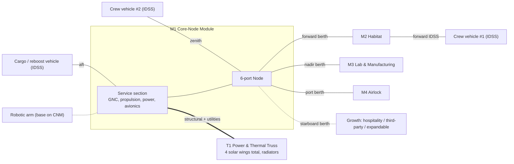
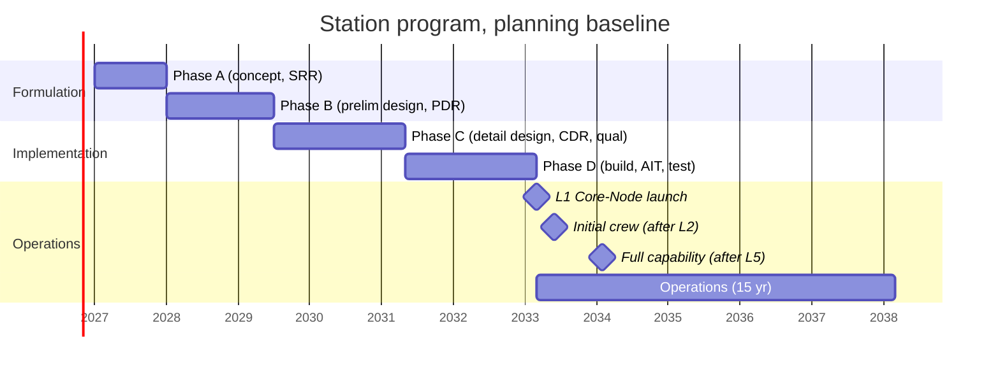

# How to read this document

This is a **first-pass concept**. It sets a baseline that holds together so later trade studies have something concrete to change. All numbers are engineering estimates unless marked otherwise. Figures quoted from real programs are limited to ones that are well established or were checked against public sources in October 2026, and each is labelled. Where a number is an estimate, it says so.

**Working name:** "Station" (placeholder, no name chosen yet).

# 0. Baseline assumptions (change these first)

Every downstream number depends on these. Changing any of them means re-running the sizing in Sections 4 to 12.

| # | Assumption | Baseline value | Why | Sensitivity if changed |
|---|---|---|---|---|
| A1 | Owner/operator | Private commercial operator. NASA and other agencies are customers, not owners | Matches the post-ISS US commercial LEO model | Medium: a NASA anchor contract adds certification requirements and cost |
| A2 | Orbit | Circular, 420 km nominal (400 to 450 km operating band), 51.6° inclination | Section 2 | High: drives launch mass, drag, radiation, crew vehicle compatibility |
| A3 | Permanent crew | 4 | Given | High: drives ECLSS, volume, logistics |
| A4 | Peak crew | 8 for up to 30 days (handovers and private visitor missions) | Visitors and crew handover overlap | Medium |
| A5 | Uses | Research (biology, materials, physical sciences), in-space manufacturing, private visitors, Earth observation | Given | Medium: power and payload allocations |
| A6 | Design life | 15 years for primary structure; replaceable arrays, batteries and ECLSS units | Typical commercial planning horizon | Medium |
| A7 | Launch vehicles | Falcon 9 and Falcon Heavy as baseline; every module also fits Vulcan, New Glenn and Starship fairings | Flying today; gives launch-vehicle redundancy | High (see trade T1) |
| A8 | Module envelope | Rigid aluminium modules, 4.4 m outer diameter (about 3.8 m inside), up to about 15 m long, up to about 27 t | Fits 5 m class fairings | High (see trade T1) |
| A9 | Crew transport | Crew Dragon as baseline; any IDSS-compatible crew vehicle is accepted | Only US crew vehicle in routine service | High: single-provider risk |
| A10 | Cargo | Cargo Dragon and other IDSS or berthing-compatible cargo vehicles | Existing commercial logistics | Medium |
| A11 | Cabin atmosphere | 101.3 kPa (sea level), about 21% O2, N2 balance | Visitor comfort; reuse of ISS-heritage hardware and procedures | Low to medium |
| A12 | Safety standard | Design to NASA human-rating practice (two-fault tolerance against catastrophic hazards where practical) so NASA can be a customer | Keeps the NASA market open | High: cost |
| A13 | Program start | Phase A begins early 2027 | Planning baseline | Schedule only |
| A14 | Margins | 25% mass growth allowance on dry mass; 15 to 30% contingency on subsystem power; plus separate system-level margins | Normal practice for a concept at this maturity | — |

# 1. Mission and requirements

## 1.1 Mission statement

Provide a permanently crewed, commercially operated platform in low Earth orbit that supports 4 permanent crew and up to 8 people for short periods, with lab, manufacturing and hospitality facilities, assembled from a few launches on commercial rockets, and able to keep operating after the ISS retires around 2030.

## 1.2 Top-level requirements

"Shall" items are design-driving. Values are first-pass and still need to be agreed.

| ID | Requirement | Value | Rationale | Verification |
|---|---|---|---|---|
| SR-01 | Crew capacity | 4 continuous; 8 for ≤30 days | A3, A4 | Analysis, demo |
| SR-02 | Design life | ≥15 yr structure; ≥10 yr for replaceable major units | A6 | Analysis, test |
| SR-03 | Orbit | 400–450 km circular, 51.6° | Section 2 | Analysis |
| SR-04 | Pressurized volume | ≥450 m³ | ≥25 m³ habitable per person at peak crew of 8 (see 4.3) | Inspection |
| SR-05 | Habitable volume | ≥240 m³ | As above | Inspection |
| SR-06 | Continuous user power (EOL, orbit-average) | ≥35 kW total, of which ≥12 kW is for payloads and manufacturing | Section 6 | Analysis, test |
| SR-07 | Water recovery | ≥95% at first crew, rising to ≥98% | Cuts resupply mass (5.4) | Test |
| SR-08 | O2 recovery from CO2 | ≥45% (Sabatier-class) | 5.4 | Test |
| SR-09 | Docking ports | ≥2 IDSS docking ports usable at the same time for crew vehicles, plus ≥1 for cargo | Crew handover and visitor missions need two lifeboats docked | Inspection |
| SR-10 | Lifeboat coverage | Docked return capacity ≥ crew on board at all times | Crew safety | Ops verification |
| SR-11 | Catastrophic hazard tolerance | Two-fault tolerant, or design-for-minimum-risk where FT is impractical | A12 | Analysis |
| SR-12 | MMOD protection | Station probability of no critical penetration ≥0.95 over 10 yr (target, to be derived) | Industry practice | Analysis (ORDEM/BUMPER-class tools) |
| SR-13 | Reboost and drag makeup | Hold altitude through solar maximum without visiting-vehicle reboost | Independence | Analysis |
| SR-14 | Collision avoidance | ≥1 m/s debris-avoidance burn within 24 h of a conjunction warning | Ops practice | Test, demo |
| SR-15 | Communications | ≥1 Gbps payload downlink; continuous TT&C coverage ≥95% of the time | Commercial users and visitors expect broadband | Test |
| SR-16 | EVA | Airlock that supports 2-person EVA | Maintenance, external payloads | Demo |
| SR-17 | Payload accommodation | ≥12 internal rack-equivalent locations; ≥2 external payload sites; 1 science airlock | Research market | Inspection |
| SR-18 | Launch compatibility | Every element ≤27 t and ≤4.4 m OD × 15 m length (plus adapter) | A7, A8 | Analysis |
| SR-19 | End of life | Controlled deorbit capability (reserved or procured) | Debris and ground safety | Analysis |
| SR-20 | Radiation | Crew dose kept inside NASA-STD-3001 limits (600 mSv career effective dose); storm shelter ≥10 g/cm² extra shielding | Crew health | Analysis |
| SR-21 | Leak rate | ≤0.05% of cabin air mass per day (target) | Consumables | Test |

# 2. Orbit selection and rationale

## 2.1 Choice

**Baseline: 420 km circular, 51.6° inclination**, with a 400–450 km operating band.

## 2.2 Inclination trade

| Factor | 51.6° (baseline) | ~43–45° | 28.5° (due east from Florida) |
|---|---|---|---|
| Launch performance from Florida | Lowest of the three (estimate: about 10–15% less than due east) | Middle | Highest |
| Crew and cargo vehicle compatibility | Dragon and Cygnus ascent, abort and recovery are already worked out for ISS at 51.6° | New ascent and abort analysis needed | New analysis needed |
| Ground track coverage | Reaches ±51.6° latitude, covering most of the world's population (useful for Earth observation and visitor views) | Smaller | Small |
| International partner launch access | Reachable from Baikonur, Florida and most other sites | Florida and some others | Mostly Florida |
| Radiation | Higher (more time at high latitude) | Lower | Lowest |
| Examples (verified Oct 2026) | ISS; Vast Haven-1 plans 425 km / 51.6° | Starlab plans 500 km / 45° (company figures) | — |

**Rationale.** 51.6° costs launch performance, but it reuses the most developed crew-transport and logistics infrastructure in the world. That matters most for a commercial operator who cannot pay for new abort and recovery certification. It also keeps us compatible with ISS-heritage operations and staff. The radiation penalty is manageable (Section 10). **This is open decision #2**: if the main customers turn out to be manufacturing users who care about mass to orbit, about 45° is worth re-examining.

## 2.3 Altitude trade

Atmospheric drag. Station mass with visiting vehicles about 120 t (estimate). Average ram-facing area 400 m² (conservative; arrays dominate). Drag coefficient Cd = 2.2. Orbital velocity at 420 km:

$v = \sqrt{\mu / a} = \sqrt{3.986\times10^{14} / 6.798\times10^{6}} \approx 7{,}657\ \text{m/s}$

$F_D = \tfrac{1}{2}\rho v^2 C_D A$

| Case | Density ρ at 420 km (estimate) | Drag F | Δv per year | Biprop (Isp 300 s) | Hall EP (Isp 1,500 s) | EP power at 60 mN/kW |
|---|---|---|---|---|---|---|
| Solar mean | 4×10⁻¹² kg/m³ | 0.10 N | 27 m/s | 1.1 t/yr | 0.22 t/yr | 1.7 kW |
| Solar max (high) | 1.5×10⁻¹¹ kg/m³ | 0.39 N | 102 m/s | 4.1 t/yr | 0.83 t/yr | 6.4 kW |

(Δv/yr = F/m × 3.156×10⁷ s; propellant ≈ m·Δv / (Isp·g₀).)

Altitude factors:

* **Lower (≈400 km):** easier to reach for crew and cargo vehicles, lower radiation, short decay time for any debris we shed, but more drag.
* **Higher (≈500 km):** less drag, but MMOD flux is generally higher and debris lasts much longer. A dead station would also stay up much longer before reentering.
* **420 km** sits in the ISS band. All visiting vehicles are qualified for it, and the drag-makeup demand is affordable with electric propulsion (Section 8).

Orbital period at 420 km: $T = 2\pi\sqrt{a^3/\mu} = 5{,}578\ \text{s} \approx 93.0\ \text{min}$. Longest eclipse (β = 0°, cylindrical shadow): half-angle $\arcsin(R_E/a) = \arcsin(6378/6798) = 69.8°$, so the eclipse fraction is 0.388. That gives about **36 min eclipse and 57 min sunlight** per orbit, about 15.5 orbits per day, and about 5,650 battery cycles per year.

# 3. Architecture and module layout

## 3.1 Architecture choice

**Baseline: 5 elements (4 pressurized + 1 power/thermal truss) on 5 launches (3 Falcon Heavy + 2 Falcon 9).** The layout follows the "core module with a multi-port node" pattern proven by Tiangong (three modules of roughly 22–23 t each). The modules use the 4.4 m diameter that Vast has adopted for Haven-1 and Haven-2.

Why modular at 4.4 m, not one big Starship-launched module (Starlab's approach):

1. It flies on rockets that exist today, with several vehicles able to carry each element.
2. If one launch is lost, the program loses one module, not the whole station.
3. A useful crewed station exists after launch 2.
4. The cost is in-orbit assembly and more interfaces. Trade T1 keeps the single-launch option open.

## 3.2 Elements

| Element | Size (OD × length) | Main functions | Ports |
|---|---|---|---|
| **M1 Core-Node Module (CNM)** | 4.4 m × 14 m | Service section: avionics, GNC (CMGs, star trackers, GNSS), main propulsion (biprop + Hall), main power distribution, 2 initial solar wings and batteries, comms. Forward 6-port node: the station's connection hub. Initial ECLSS set. Robotic arm base. | Aft IDSS docking (cargo and reboost); node: forward, nadir, port, starboard berthing ports; zenith IDSS docking; base for the truss |
| **M2 Habitat Module (HAB)** | 4.4 m × 14 m | 8 crew quarters (4 permanent + 4 visitor), galley/wardroom, 2 hygiene stations, exercise, full regenerative ECLSS racks, radiation storm shelter (water-walled crew quarters) | Aft berthing to node; forward IDSS docking (crew vehicle #1) |
| **M3 Laboratory & Manufacturing Module (LAB)** | 4.4 m × 14 m | 12+ payload racks, glovebox, manufacturing furnace/bioprinting bays, science airlock, Earth-facing window (≈1 m class), 2 external payload sites | Berths to node nadir |
| **M4 Airlock Module (ALM)** | 3.0 m × 5 m | Crew lock + equipment lock, 2 EVA suits, depress pump | Berths to node port side |
| **T1 Power & Thermal Truss (PTT)** | Stowed ≈4 m × 12 m | 2 more solar wings with beta gimbals, alpha rotary joint, 2 deployable radiator wings, external ammonia pump modules, extra batteries | Structural/utility interface on CNM zenith/aft service section |
| *Growth port* | — | Node starboard: commercial "hospitality" module, a third-party module, or an expandable habitat | Berthing |

## 3.3 Module connectivity

**Port summary:** 3 IDSS docking ports (HAB forward, Node zenith, CNM aft) and 4 berthing ports (Node forward/nadir/port/starboard, one free for growth). IDSS gives an 800 mm passage. For permanent module-to-module joints we use a CBM-heritage berthing interface with a larger square hatch (about 1.27 m) so racks can move between modules.

**Flight attitude:** long axis (CNM-HAB) along the velocity vector, LAB pointing at Earth (nadir), truss pointing away from Earth (zenith) and perpendicular to the orbit plane. The station flies near its torque-equilibrium attitude (Section 8).

# 4. Structures and pressurized volume

## 4.1 Primary structure

* **Material:** welded aluminium-lithium 2195 or aluminium 2219 (ISS and Haven heritage), with machined isogrid or orthogrid panels, forged end rings and bulkheads.
* **Design pressure:** maximum expected operating pressure (MEOP) 104 kPa; ultimate factor 2.0 on pressure (typical for crewed pressurized structure; confirm against the applicable standard, e.g. NASA-STD-5001 family).
* **Sizing check (pressure only).** Hoop stress σ = p·r/t:

$t_{min} = \dfrac{p \cdot r \cdot FS}{\sigma_{allow}} = \dfrac{104\,\text{kPa} \times 1.9\,\text{m} \times 2.0}{270\,\text{MPa}} \approx 1.5\ \text{mm}$

Here σ_allow = 270 MPa assumes ≈455 MPa ultimate for 2219-T87 with ≈0.6 weld knock-down. **Pressure is not what sizes the wall.** Launch loads, handling, damage tolerance, fracture control and pressure cycling do. A realistic equivalent skin with stiffeners is 5–6 mm (estimate).

* **Shell mass estimate (14 m module):** 4.0 m mean shell diameter, so area ≈ π × 4.0 × 14 ≈ 176 m². At 6 mm equivalent aluminium (≈16.8 kg/m²) that is ≈3.0 t, plus end domes, rings, hatches and secondary structure ≈1.5–2.0 t. **Total ≈4.5–5 t primary structure per module.**
* **MMOD shielding:** stuffed Whipple shields (outer aluminium bumper + Nextel/Kevlar layer + standoff) on ≈200 m² per module at ≈8–12 kg/m², so ≈2 t per module (estimate). See Section 10.
* **Loads:** launch quasi-static loads and the launch vehicle's random vibration environment; berthing/docking loads; re-boost; crew push-off. Cases that usually size the structure: launch axial/lateral, and docking with a heavy vehicle at the end of a long stack.

## 4.2 Pressurized volume

Internal diameter 3.8 m, so cross-section ≈ π(1.9)² = 11.34 m².

| Element | Pressurized geometry | Pressurized volume (estimate) |
|---|---|---|
| CNM | 9 m cylinder (102 m³) + node section ≈45 m³ | ≈145 m³ |
| HAB | 13 m cylinder (147 m³) + domes | ≈155 m³ |
| LAB | 13 m cylinder + domes | ≈155 m³ |
| ALM | 3.0 m ID crew + equipment lock | ≈30 m³ |
| **Total** | | **≈485 m³** |
| **Habitable (≈55% of pressurized, estimate)** | | **≈265 m³** |

## 4.3 Is that enough?

* Commonly used planning guideline for long-duration missions: about 25 m³ net habitable volume per person (rule of thumb, not a hard standard). With 8 people that is 200 m³ and with 4 it is 100 m³. **265 m³ meets the peak case with ≈30% margin** and is generous for 4.
* For comparison (verified figures):

| Station | Pressurized volume | Habitable volume | Source/status |
|---|---|---|---|
| ISS | ≈916 m³ | ≈388 m³ | NASA facts; operating |
| Starlab | ≈450 m³ | — | Company/partner materials; single Starship launch targeted 2029 |
| Vast Haven-1 | 80 m³ | 45 m³ | Vast; launch now planned Q1 2027 on Falcon 9 |
| Vast Haven-2 first module | 127 m³ | 55 m³ | Vast presentation (4.4 m OD × 16 m, 29 t, Falcon Heavy with expendable core and stretched fairing) |
| **This concept** | **≈485 m³ (est.)** | **≈265 m³ (est.)** | — |

## 4.4 Fairing fit

A 14 m module plus adapter is longer than the standard Falcon fairing allows. **We assume the extended-length Falcon fairing** that Vast's Haven-2 plan also relies on. This is a risk to confirm with SpaceX early (R2). Vulcan, New Glenn (7 m fairing) and Starship all fit with margin. A fallback is to shorten HAB and LAB to ≈11 m, which costs ≈70 m³ in total.

# 5. Environmental control and life support (ECLSS)

## 5.1 Approach

**Regenerative, ISS-class closure from the first permanent crew**, with stored consumables as backup and an open-loop surge capacity for 8-person periods. Each function has two independent methods (dissimilar redundancy) for two-fault tolerance on life-critical functions.

| Function | Primary | Backup / dissimilar |
|---|---|---|
| CO2 removal | Solid-sorbent (molecular sieve class) that **captures** CO2 for reduction | Amine swing bed (vents CO2 overboard); LiOH cartridges (emergency) |
| O2 generation | PEM water electrolysis | High-pressure O2 tanks; solid-fuel O2 candles (emergency) |
| CO2 reduction | Sabatier reactor (CO2 + 4H2 → CH4 + 2H2O); methane vented | None needed (non-critical; lower closure if it fails) |
| Water recovery | Humidity condensate + urine processor (vapour-compression distillation) + water processor (multifiltration + catalytic oxidation) + brine processor | Stored water reserve ≥30 days |
| Trace contaminants | Activated charcoal + catalytic oxidiser | Second unit |
| Atmosphere monitoring | Mass-spectrometer major constituents + trace gas analyser | Portable O2/CO2 monitors |
| Pressure control | N2/O2 makeup from tanks; positive and negative pressure relief | Manual valves |
| Fire detection/suppression | Smoke and particulate sensors per module; water-mist and CO2 portable extinguishers; module isolation and ventilation shutoff | Masks, PBA |

Real-world anchor: ISS ECLSS demonstrated about **98% water recovery** in 2023 after adding a brine processor (NASA-reported). Sabatier-based systems on ISS recover roughly **half** of the oxygen in exhaled CO2. Our mass balance below reaches the same figure.

## 5.2 Per-person metabolic loads (nominal planning values, approximate)

| Item | kg/person/day |
|---|---|
| O2 consumed | 0.84 |
| CO2 produced | 1.04 |
| Drinking + food-prep water | 2.5 |
| Hygiene + flush water (low-water hygiene; visitors may want more) | ≈1.5 |
| Food (incl. packaging) | ≈1.8 |

## 5.3 Oxygen loop mass balance (4 crew)

1. O2 needed: 4 × 0.84 = **3.36 kg/day**.
2. Electrolysis water needed: 3.36 × (36/32) = **3.78 kg H2O/day**, which also makes **0.42 kg H2/day** (210 mol).
3. CO2 produced: 4 × 1.04 = **4.16 kg/day**.
4. Sabatier reaction (H2-limited): 210 mol H2 react with 52.5 mol CO2 (2.31 kg). This makes 105 mol H2O (**1.89 kg/day**) and 52.5 mol CH4 (0.84 kg/day, vented).
5. Water returned to electrolysis: 1.89 of 3.78 kg, so **50% O2 loop closure**. The other 1.85 kg/day of CO2 is vented.
6. Net water to make up for O2: ≈1.9 kg/day. Part of this is covered by the water in food and by metabolic water. The rest is resupplied.

## 5.4 Water loop and resupply impact

* Water processed: 4 crew × ≈4 kg/day ≈ **16 kg/day**.
* At 98% recovery the loss is ≈0.3 kg/day. Adding the O2 makeup, **net water resupply ≈1–2 kg/day ≈ 0.4–0.7 t/yr** (estimate).
* Open loop would need ≈16 kg + 3.8 kg ≈ 20 kg/day ≈ **7.2 t/yr**. **Regeneration saves ≈6.5 t/yr of upmass.** At commercial cargo prices that pays for the ECLSS hardware within a few years.

## 5.5 Atmosphere and leakage

* Cabin air mass: 485 m³ × 1.2 kg/m³ ≈ 580 kg. At the 0.05%/day leak target that is 0.29 kg/day ≈ **105 kg/yr N2/O2**, plus airlock losses ≈ a few kg per EVA.
* 8-person peaks: ECLSS sized for 4 continuous and 8 for 30 days. The difference is covered by running both CO2 removal units, stored O2 and extra water, and by the visiting vehicle's own systems.

## 5.6 Logistics resupply (4 crew, estimate)

| Item | t/yr |
|---|---|
| Food | 2.6 |
| Water (net) | 0.6 |
| Gas (N2/O2 makeup, EVA) | 0.4 |
| Spares and maintenance | 2.0 |
| Crew supplies, clothing, hygiene | 0.5 |
| Chemical propellant | 0.8 |
| Xenon/krypton (solar-mean to solar-max) | 0.2–0.8 |
| Payloads (customer) | 2–4 |
| **Total** | **≈9–12 t/yr**, about 2–3 cargo flights per year |

# 6. Power

## 6.1 Architecture

* **Arrays:** 4 roll-out solar wings (ROSA/iROSA-type, flight-proven on ISS) using multi-junction cells. Two wings launch on the CNM and two on the truss. Two-axis sun tracking (alpha rotary joint + beta gimbals) is required because the β angle at 51.6° reaches ≈75° (51.6° + 23.4°). With single-axis tracking, output would drop to cos 75° ≈ 26%.
* **Storage:** Li-ion batteries, N+1 strings.
* **Distribution:** 120 Vdc main distribution (close to ISS secondary power at 124 Vdc, so heritage loads can be reused), with a dedicated high-voltage converter for the Hall thrusters. Redundant cross-strapped channels A/B.

## 6.2 Load requirement

Design target: **35 kW orbit-average user power at end of life (EOL)**. Section 12.2 derives this (28 kW demand with contingency + 25% system margin). For reference, Starlab advertises 35 kW continuous for a 4-crew station (company figure).

## 6.3 Array sizing (math)

Energy balance (SMAD method):

$P_{SA} = \dfrac{\dfrac{P_e T_e}{X_e} + \dfrac{P_d T_d}{X_d}}{T_d}$

* P_e = P_d = 35 kW (eclipse and daylight loads)
* T_e = 36.0 min, T_d = 56.9 min (Section 2.3)
* X_e = 0.75 (path through battery: charge, discharge, converters), X_d = 0.90 (direct path)

$P_{SA} = \dfrac{35 \times 36.0/0.75 + 35 \times 56.9/0.90}{56.9} = \dfrac{1680 + 2213}{56.9} \approx 68.4\ \text{kW}$

The arrays must deliver **≈68 kW in sunlight at EOL**.

Array output per m²:

* 1,361 W/m² × 30% cell efficiency × 0.85 packing × 0.90 temperature × 0.95 other losses ≈ **297 W/m² BOL**
* Degradation 1.5%/yr over 15 yr: 0.985¹⁵ = 0.80, so **≈237 W/m² EOL**
* Area required: 68,400 / 237 ≈ **289 m²**. Baseline is **300 m² active area (4 wings × 75 m²)**.

| | BOL | EOL (15 yr) |
|---|---|---|
| Array output, sun-pointed | ≈89 kW | ≈71 kW |
| Orbit-average user power | ≈46 kW | ≈36 kW |

Mitigation and upgrade path: the arrays can be swapped or augmented (as ISS did with iROSA) after ~10 years, so the 15-yr degradation figure is conservative.

**Initial configuration (CNM only, 2 wings, 150 m²):** ≈44 kW BOL sun-pointed, so ≈23 kW orbit-average. That is enough for uncrewed checkout and the first crew before the truss arrives.

## 6.4 Battery sizing (math)

* Eclipse energy: 35 kW × 36 min = 21.0 kWh delivered. At 0.9 discharge-path efficiency, **23.3 kWh** comes out of the cells.
* Cycle life: ≈5,650 cycles/yr; ≈56,000 cycles over 10 yr. That needs shallow cycling: **≤30% depth of discharge** (estimate for space Li-ion at this cycle count).
* Required capacity: 23.3 / 0.30 = 78 kWh. With one failed string tolerated (5 strings, 4 needed): 78 × 5/4 ≈ **97 kWh, so 100 kWh nameplate**.
* Mass at ≈130 Wh/kg pack level (estimate): ≈**770 kg**. Split 50/50 between CNM and truss. Plan replacement at year 8–10 by robotic arm/EVA.

# 7. Thermal control

## 7.1 Architecture

* **Passive:** MLI blankets on all pressurized shells (under the MMOD shield), optical coatings, heaters on lines and external equipment.
* **Internal active loop (in each module):** single-phase **water** loop (non-toxic inside the cabin), cold plates for avionics, air-to-liquid heat exchangers for cabin air and humidity removal (condensate goes to water recovery).
* **External active loop:** single-phase loop through **deployable radiators** on the truss plus body-mounted radiator panels on the modules. Interface heat exchangers between the internal and external loops sit outside the pressurized volume.
* **Working fluid (open trade T5):** ammonia (ISS heritage, excellent thermal properties, freezes around −78 °C, but toxic if it leaks into the cabin) vs. a non-toxic fluid such as a fluorinated heat-transfer fluid or propylene-glycol/water (safer, but needs more pumping power and larger radiators or has a freeze risk). Baseline: ammonia outside, water inside, with the interface heat exchangers outside the cabin and isolation valves. Same principle as ISS.

## 7.2 Radiator sizing (math)

Heat to reject: nearly all electrical power ends up as heat, plus crew metabolic heat (8 × ≈0.15 kW ≈ 1.2 kW) and solar/IR heating through the insulation. Design value: **40 kW** peak orbit-average.

Net heat flux per side:

$q = \eta_{fin}\,\varepsilon\,\sigma\,(T_r^4 - T_{sink}^4)$

* ε = 0.85, σ = 5.67×10⁻⁸ W/m²K⁴, mean radiator temperature T_r = 280 K, effective sink T_sink = 230 K (LEO, includes Earth IR and albedo; estimate), fin efficiency 0.90
* T_r⁴ − T_sink⁴ = 6.15×10⁹ − 2.80×10⁹ = 3.35×10⁹ K⁴
* q = 0.90 × 0.85 × 5.67×10⁻⁸ × 3.35×10⁹ ≈ **145 W/m² per side**, so **290 W/m² for a two-sided deployable panel**

Area: 40,000 / 290 ≈ 138 m² planform. Adding 25% for coating degradation and worst-case hot orbits (high β, high albedo) gives **≈175 m²**. Baseline: **2 deployable radiator wings × ≈75 m² on the truss + ≈30 m² body-mounted**. The radiators are rotated edge-on to the Sun by a dedicated radiator rotary joint.

Before the truss arrives, the CNM's body-mounted radiators and the initial 2-wing power level (~23 kW) limit total load. That is consistent with uncrewed and initial crew operations.

# 8. Guidance, navigation and control; reboost and propulsion

## 8.1 Attitude control

* **Actuators:** 4 control moment gyroscopes (CMGs) in a pyramid layout, plus RCS thrusters to desaturate them.
* **Attitude:** LVLH-referenced, flown near **torque-equilibrium attitude (TEA)** to cancel gravity-gradient and aerodynamic torques, as ISS does.
* **CMG sizing estimate:**
    * Inertia difference between principal axes ΔI ≈ 5×10⁶ kg·m² (estimate: ≈84 t over a ≈35 m stack plus arrays).
    * Orbital rate squared ω₀² = μ/a³ = 1.27×10⁻⁶ s⁻².
    * Gravity-gradient torque at a 5° attitude offset: 3ω₀²ΔI·sinθ·cosθ ≈ 3 × 1.27×10⁻⁶ × 5×10⁶ × 0.087 ≈ **1.7 N·m**.
    * Held for a whole orbit, that builds up ≈9,000 N·m·s. This is why the station must fly TEA.
    * At TEA, the remaining cyclic torques (aero ≈0.1–0.4 N × ~5 m arm ≈ 0.5–2 N·m) give cyclic momentum of order 1 N·m × T/2π ≈ **900 N·m·s**.
    * **Selection: 4 CMGs of ≈1,200 N·m·s each** (estimate). For comparison, ISS CMGs are ≈4,760 N·m·s each for a station about five times heavier.
* **Sensors:** 3 star trackers, 2 IMUs (fibre-optic/hemispherical-resonator gyros), sun sensors, magnetometers.

## 8.2 Navigation

* Dual GNSS receivers (GPS + Galileo) for orbit determination; ground tracking as a backup.
* Rendezvous support: GNSS relative-navigation data broadcast, docking targets, retro-reflectors and lights on every IDSS port. Visiting vehicles bring their own rendezvous sensors.

## 8.3 Propulsion

Two systems:

| System | Purpose | Sizing |
|---|---|---|
| **Hall-effect electric propulsion** (2 × ≈4.5 kW thrusters + spare; xenon or krypton) | Routine drag makeup | Solar mean: 0.10 N needs ≈1.7 kW continuous, 0.22 t/yr propellant. Solar max: 0.39 N needs ≈6.4 kW; run at higher duty in sunlight and borrow from payload power if needed |
| **Bipropellant RCS / delta-v** (MMH/MON-3, ≈300 s Isp; 2.5 t initial load on CNM) | Debris avoidance, attitude control during dockings, CMG desaturation, backup reboost | See below |

Annual chemical Δv budget (estimate): debris avoidance 3 × 1 m/s; desaturation and backup 5 m/s; 30-day EP outage at solar max ≈8 m/s. Total ≈16 m/s, which is 120 t × 16 / 2,943 ≈ **0.65 t/yr**, plus ≈0.2 t/yr RCS during dockings, so **≈0.85 t/yr**. The 2.5 t initial load covers ≈3 years without resupply.

**Refuelling:** a propellant-transfer coupling at the CNM aft port (Progress-style; there is no standard IDSS fluid interface today, see risk R6). As a backup, a docked cargo vehicle can reboost the station: Cygnus has reboosted ISS, and a Cargo Dragon demonstrated a reboost in late 2024.

**End of life:** a controlled reentry from 420 km means lowering perigee to ≈50 km. Δv = v_circ − v_apogee = 7,657 − 7,549 ≈ **108 m/s**. At 84 t with Isp 300 s that needs ≈3.0 t of propellant and high thrust. Baseline: let the orbit decay to ≈250–300 km (less Δv), then use a **dedicated deorbit vehicle** procured near end of life (the same approach as NASA's ISS deorbit vehicle) or extra propellant brought by a cargo vehicle. Cost carried in the operations phase.

# 9. Communications and data

| Link | Approach | Performance target |
|---|---|---|
| High-rate payload/crew internet | Optical inter-satellite links to a commercial LEO relay constellation (e.g., Starlink laser terminals, which Vast has announced for Haven-1) | ≥1 Gbps, low latency, near-continuous |
| Backup high-rate | Ka-band direct-to-ground through commercial ground networks | ≥300 Mbps per pass |
| TT&C (command, telemetry) | Dual S-band transponders to commercial ground stations; in addition, a relay service (commercial or the NASA relay network while it remains available) | Continuous ≥95%; independent of the payload internet |
| Proximity | S-band/UHF links to visiting vehicles and EVA suits; wireless inside the cabin | — |

**S-band TT&C link check (direct to ground, worst case 10° elevation):**

* Slant range at 420 km altitude, 10° elevation: ≈1,490 km
* Free-space loss at 2.2 GHz: 20·log₁₀(4πd/λ) ≈ **162.8 dB**
* Transmit 5 W (7 dBW) through a 3 dBi near-omni antenna: EIRP 10 dBW. Ground 7 m dish G/T ≈ 21 dB/K (estimate). Pointing, polarisation and other losses: 3 dB
* C/N₀ = 10 − 162.8 − 3 + 21 + 228.6 ≈ **93.8 dB-Hz**
* 2 Mbps telemetry needs 63 + ≈4.5 dB (coded Eb/N₀) ≈ 67.5 dB-Hz, so **≈26 dB margin**. Omni antennas are acceptable, which means TT&C does not depend on attitude.

**Avionics and data:**

* Triple-redundant fault-tolerant flight computers (2-fault tolerant for vehicle control), on a deterministic network (time-sensitive Ethernet), with a separate payload/visitor network.
* Onboard edge computing and ≥100 TB storage for manufacturing and science data.
* Cybersecurity: separate networks for flight control and payloads/visitors; encrypted command links; principles aligned with US Space Policy Directive-5. Visitor devices never reach flight networks.

# 10. Crew safety, radiation and debris protection

## 10.1 Safety philosophy

* Two-fault tolerance against catastrophic hazards (loss of crew/station) where practical. Where it isn't (structure, pressure vessels, windows), use design for minimum risk with margins, fracture control and inspection.
* **Lifeboats:** docked crew vehicles provide return capacity for everyone on board at all times (SR-10). Each visitor mission brings its own vehicle.
* **Emergencies the design must handle:** fire, rapid depressurisation, toxic atmosphere (including ammonia leak), medical emergency, and loss of power or attitude control.

## 10.2 Depressurisation response time (math)

Choked air leak through a hole of area A:

$\dot m = C_d A p_0 \sqrt{\dfrac{\gamma}{R T}} \left(\dfrac{2}{\gamma+1}\right)^{\frac{\gamma+1}{2(\gamma-1)}}$

With C_d = 0.6, A = 1 cm², p₀ = 101.3 kPa, T = 295 K, γ = 1.4: ṁ ≈ 0.014 kg/s. Cabin mass 580 kg, so the decay time constant τ = 580/0.014 ≈ 11 h. **Time to fall to 70 kPa: τ·ln(101.3/70) ≈ 4.2 h** for a 1 cm² (11 mm) hole, and ≈25 min for 10 cm². Plenty of time to find the leak, isolate the module (hatches stay closable; no permanent hatch-blocking cables) or evacuate to the lifeboats. Requirement: ΔP/Δt sensing in every module and automated alarms.

## 10.3 Radiation

* Environment at 420 km / 51.6°: trapped protons (South Atlantic Anomaly), galactic cosmic rays, occasional solar particle events. ISS crews typically receive on the order of **0.3–0.8 mSv/day** (estimate; depends on solar cycle and location in the station).
* Against the NASA-STD-3001 career limit of 600 mSv, a 6-month mission at ≈0.5 mSv/day uses ≈90 mSv. Permanent crew can fly several long missions. Visitors (≤30 days, ≈15 mSv) are not dose-limited.
* Design: crew quarters in HAB lined with water and polyethylene (stored water does double duty), giving ≥10 g/cm² extra shielding as a storm shelter. Active dosimeters in every module and personal dosimeters for crew. Space-weather alerts feed operations.

## 10.4 Micrometeoroid and orbital debris (MMOD)

* **Passive:** stuffed Whipple shielding on all pressurized surfaces (Section 4). Extra protection on ram-facing and port/starboard surfaces, where the debris flux is highest. Analysis with NASA ORDEM and BUMPER-class tools to show SR-12 is met.
* **Active:** conjunction screening (US Space Force data plus commercial space-situational-awareness providers). Manoeuvre when the probability of collision exceeds about 1 in 10,000 (the ISS-practice threshold), using the chemical system (SR-14).
* **Tolerance:** leak detection and isolation (10.2); repair kits for shield and hull patches; spare array strings.

## 10.5 Other

Medical: an advanced medical kit, telemedicine over the broadband link, and ≥1 crew medical officer per increment. Visitors are screened before flight. Mobility aids and window covers to protect against micrometeoroid damage.

# 11. Launch and assembly sequence

| # | Launch | Vehicle (baseline) | Element | What it enables | Month (from L1) |
|---|---|---|---|---|---|
| L1 | 1 | Falcon Heavy (expendable core, extended fairing) | **M1 Core-Node** (≈26.6 t incl. propellant) | Free-flying, powered, controlled station; arm checkout | 0 |
| L2 | 2 | Falcon Heavy | **M2 Habitat** (≈21 t) | Self-propelled module docks to Node forward port using a temporary propulsion/avionics kit (Tiangong-style), then is berthed | +2 |
| C1 | — | Crew Dragon | First crew (4) | **Initial crewed capability** (≈23 kW, CNM + HAB) | +3 |
| L3 | 3 | Falcon 9 | **T1 Power & Thermal Truss** (≈11.4 t) | Captured by the arm and installed on CNM; full power and heat rejection | +5 |
| L4 | 4 | Falcon Heavy | **M3 Laboratory** (≈19.3 t) | Arm captures and berths it at Node nadir; payload operations begin | +7 |
| L5 | 5 | Falcon 9 | **M4 Airlock** (≈5.6 t) | Arm berths it at Node port; EVA capability | +9 |
| — | — | Cargo flights | Payloads, spares | **Full operational capability** | ≈+10 to +12 |

**Assembly method:** HAB uses the "dock then berth" method (the module's own propulsion takes it to an IDSS port). LAB, TRUSS and ALM fly with a free-flyer kit or are released by the upper stage to a capture box near the station, then are **grappled and berthed by the station arm** (ISS/Cygnus heritage). The arm is a 2-end "walking" arm of ≈15 m (buy vs build: trade T8).

**Launch count: 5 station launches (3 Falcon Heavy + 2 Falcon 9)**, plus one crew flight to reach initial capability.

**Alternatives:** New Glenn (7 m fairing, ≈45 t class LEO) could carry any element, or combine ALM with TRUSS (4 launches). A Starship could, in principle, carry CNM + HAB together. Each module's mass and length are kept inside several vehicles' capability so we never depend on a single rocket.

# 12. Mass and power budgets

## 12.1 Mass budget

CBE = current best estimate. MGA = mass growth allowance (25% on dry mass at concept stage; consumables/propellant carry no MGA). All values in tonnes, all estimates.

| Item | CNM | HAB | PTT | LAB | ALM |
|---|---|---|---|---|---|
| Primary structure | 5.5 | 4.8 | 2.5 | 4.8 | 2.0 |
| MMOD shielding | 2.0 | 2.0 | — | 2.0 | 0.6 |
| Propulsion (dry) | 1.2 | — | — | — | — |
| GNC (CMGs, sensors) | 1.0 | — | — | — | — |
| Avionics & comms | 0.8 | 0.4 | 0.2 | 0.5 | 0.2 |
| Power (wings, gimbals, batteries, PMAD) | 2.2 | — | 2.8 | — | — |
| Alpha rotary joint | — | — | 1.0 | — | — |
| Thermal (loops, radiators, pumps) | 1.2 | 0.8 | 2.6 | 0.8 | 0.2 |
| ECLSS | 1.5 | 2.5 | — | — | 0.4 |
| Docking / berthing mechanisms | 0.7 | 0.6 | — | 0.4 | 0.3 |
| Robotic arm | 1.5 | — | — | — | — |
| Crew quarters, galley, hygiene, exercise | — | 3.5 | — | — | — |
| Payload infrastructure, furnace, science airlock, window | — | — | — | 5.1 | — |
| EVA suits & support | — | — | — | — | 0.8 |
| Harness & outfitting | 1.4 | 0.6 | — | 0.6 | — |
| **Dry CBE** | **19.0** | **15.2** | **9.1** | **14.2** | **4.5** |
| MGA (25%) | 4.8 | 3.8 | 2.3 | 3.6 | 1.1 |
| Consumables / propellant / initial cargo | 2.8 | 2.0 | — | 1.5 | — |
| **Launch mass (with MGA)** | **26.6** | **21.0** | **11.4** | **19.3** | **5.6** |
| Vehicle | FH | FH | F9 | FH | F9 |

**Station total ≈ 84 t (with MGA)**, about one-fifth of the ISS's ≈420 t.

**Launch margin check:**

* **Falcon Heavy elements (≤27 t):** comfortable margin with an expendable core even at 51.6° (Haven-2's 29 t module is planned on the same configuration). The binding constraint is fairing length, not mass.
* **Falcon 9 elements:** the truss at ≈11.4 t needs about a 20% margin against Falcon 9's capability to a ≈51.6° insertion orbit. Haven-1 (≈14.6 t on Falcon 9) suggests this is achievable, **but it must be confirmed with SpaceX** for the specific insertion orbit. Fallback: fly the truss on Falcon Heavy.

## 12.2 Power budget (orbit-average, EOL)

| Subsystem | CBE (kW) | Contingency | With contingency (kW) |
|---|---|---|---|
| ECLSS (4 crew, regenerative incl. electrolysis ≈1.2 kW) | 4.2 | 20% | 5.0 |
| Thermal control (pumps, fans, heaters) | 2.1 | 20% | 2.5 |
| Avionics, C&DH, comms | 1.7 | 20% | 2.0 |
| GNC (CMGs, sensors) | 0.8 | 25% | 1.0 |
| Crew systems (galley, hygiene, exercise, lighting, IT) | 2.5 | 20% | 3.0 |
| Robotics (orbit-average) | 0.4 | 25% | 0.5 |
| **Payloads incl. manufacturing (allocation)** | 12.0 | — | 12.0 |
| **Electric propulsion (solar-mean allocation)** | 2.0 | — | 2.0 |
| **Total demand** | 25.7 | | **28.0** |
| **Capability (EOL)** | | | **35–36** |
| **System margin** | | | **≈7 kW (20% of capability, 25% over demand)** |

Electrolysis estimate: 3.36 kg O2/day at ≈30 MJ/kg O2 (theoretical 17.9 MJ/kg at ≈60% efficiency) = 101 MJ/day ≈ 1.2 kW average.

**Solar-max case:** EP needs up to ≈6.4 kW, which takes ≈4.4 kW more of the system margin. Payloads remain whole at EOL. At BOL (≈46 kW) there is plenty.

**8-person case:** +≈2.5 kW (ECLSS, crew systems) is within margin.

# 13. Cost and schedule outline (ROM)

## 13.1 Cost: rough order of magnitude (2026 US$, all estimates, ±50% or worse)

| Phase / item | ROM | Notes |
|---|---|---|
| Phase A–B (concept to PDR), incl. technology risk reduction | $0.3–0.5 B | ≈150–300 engineers; ECLSS and berthing development tests |
| Phase C–D development, qualification & flight hardware (5 elements, test articles, ground test, software, ground segment) | $2.5–4.0 B | Dominant cost. Assumes commercial practices and reuse of heritage subsystems (IDSS, ROSA-type arrays, ISS-class ECLSS) |
| Launch (3 × FH expendable core + 2 × F9) | ≈$0.5–0.7 B | Estimate: ≈$120–180M per FH (expendable core), ≈$70M per F9 |
| Program reserve (≈20–25%) | $0.7–1.2 B | |
| **Total to full operational capability** | **≈$4–6 B** | |
| Annual operations (mission control, sustaining engineering, 2–3 cargo flights, spares, insurance); excludes customer-paid crew seats | ≈$0.3–0.6 B/yr | Crew transport usually billed to customers or agencies |

For reference: NASA's Commercial LEO Destinations Space Act Agreements are worth hundreds of millions of dollars per company (e.g., ≈$217.5M awarded to Starlab, per public reporting). That is a small fraction of a station's total development cost, so private capital and pre-sold customer commitments must fund most of it. The ISS is commonly described as a programme of order $100B+; our design is far cheaper mostly because it is smaller and reuses commercial launch and existing subsystem designs.

## 13.2 Schedule (planning baseline, starting 2027)

* **Baseline:** first launch ≈6 years after start (≈2033). **Aggressive:** ≈5 years (2032) if subsystems are bought rather than developed and Phase A/B are compressed. For comparison, Starlab completed CDR in February 2026 and targets launch in 2029. Haven-1 began integration in January 2026 for a Q1 2027 launch.
* **Implication:** the ISS is planned to retire around 2030, so this station would arrive *after* the first commercial stations. It must differentiate on capacity (power, volume, manufacturing, hospitality), or partner with or supply an existing operator.

Major reviews: SRR (month 9), SDR (12), PDR (30), CDR (52), module-level pre-ship reviews, flight readiness review per launch.

# 14. Key risks and open trade studies

## 14.1 Top risks (L = likelihood, C = consequence, 1–5)

| ID | Risk | L | C | Mitigation |
|---|---|---|---|---|
| R1 | **Funding and demand:** not enough paying customers or capital to close the ≈$4–6B business case | 4 | 5 | Anchor customers early (agencies, pharma/semiconductor manufacturing, sovereign astronauts); phase investment so a crewed station exists after L2 |
| R2 | **Extended fairing** availability/cost for 14 m modules | 3 | 4 | Early SpaceX engagement; design to fit New Glenn/Vulcan as alternates; fallback to 11 m modules |
| R3 | **Crew transport single point of failure** (Crew Dragon only) | 3 | 5 | IDSS standard ports for any vehicle; stored consumables for ≥6 months without visitors |
| R4 | **ECLSS reliability** (ISS experience shows regenerative units need frequent maintenance) | 3 | 4 | Dissimilar redundancy, robust spares strategy, early long-duration ground testing |
| R5 | **On-orbit assembly** (berthing failure, arm failure before modules are joined) | 2 | 5 | Dock-capable modules as a backup; arm with redundant joints; Tiangong/ISS-proven methods |
| R6 | **Propellant resupply** (no standard fluid-transfer interface on commercial cargo vehicles) | 3 | 3 | EP for routine drag; visiting-vehicle reboost; early agreement with a cargo provider |
| R7 | **MMOD/debris growth** in LEO | 3 | 4 | Shielding and active avoidance; 420 km is below the densest shells |
| R8 | **Schedule:** competitors fill the market first | 4 | 4 | Partner/differentiate; consider supplying modules to other stations |
| R9 | **Regulatory:** US authorisation/oversight framework for commercial on-orbit activities is still evolving; FAA/FCC/NOAA licensing | 3 | 3 | Engage regulators in Phase A |
| R10 | **Solar max drag** exceeding EP capability | 2 | 3 | Chemical reboost reserve; temporarily raise altitude ahead of solar max |

## 14.2 Open trade studies

| ID | Trade | Options | Drivers |
|---|---|---|---|
| T1 | **Launch architecture** | (a) Baseline: 5 × 4.4 m modules, F9/FH. (b) 2–3 large modules (≈6.5 m) on New Glenn. (c) Single monolith on Starship | Cost, launch risk, schedule, fairing availability |
| T2 | **Orbit** | 51.6° / 420 km (baseline) vs 45° / 450–500 km | Customer base, crew vehicle certification, radiation, performance |
| T3 | **Habitat construction** | Rigid aluminium vs expandable (softgoods) habitat (BEAM flew on ISS from 2016) | Volume per launch, MMOD, maturity |
| T4 | **Reboost** | Hall EP + chem (baseline) vs chemical only vs visiting-vehicle reboost | Power vs propellant logistics |
| T5 | **External coolant** | Ammonia vs non-toxic fluid | Crew safety vs mass/power |
| T6 | **ECLSS closure level** | ISS-class (≈98% water, ≈50% O2) vs Bosch/advanced CO2 reduction for higher O2 closure vs more open-loop to start | Resupply cost vs development risk |
| T7 | **Cabin pressure** | 101.3 kPa vs reduced pressure (≈70 kPa, higher O2) to shorten EVA prebreathe | Fire risk, visitor comfort, hardware heritage |
| T8 | **Robotic arm** | Buy (e.g., from an established space robotics supplier) vs build | Cost, schedule |
| T9 | **Power bus voltage** | 120 Vdc vs higher voltage (≈300 V) | Harness mass, EP compatibility, heritage |
| T10 | **Ownership of crew/visitor transport** | Station buys seats vs customers contract directly | Business model, lifeboat guarantee |

# 15. Next steps

**Next 30 days**

1. Owner reviews and confirms or changes assumptions A1–A14, especially the three open decisions below.
2. Set up the requirements baseline (move Section 1 into a controlled requirements tool) and a mass/power/volume model (spreadsheet or parametric model) that re-runs Sections 6–12 automatically.
3. Talk to launch providers (SpaceX on extended fairing and Falcon 9 truss capability; Blue Origin on New Glenn; ULA) and crew/cargo vehicle providers on interfaces and pricing.

**Next 90 days (Phase A start)**

4. Run trades T1 (launch architecture) and T2 (orbit) first. Everything else depends on them.
5. Market study: rank customer segments (agencies, biotech/pharma, semiconductor/fibre manufacturing, sovereign astronaut programs, private visitors) and their willingness to pay. Target letters of intent.
6. Make-or-buy survey for ECLSS, arrays, berthing/docking mechanisms, CMGs, arm and EVA suits. Pick heritage suppliers where possible.
7. Write the Concept of Operations (crew rotation, logistics cadence, visitor missions, ground segment).
8. Draft the safety plan and hazard analysis framework aligned with NASA human-rating practice (if NASA is a target customer).
9. Funding strategy: private raise plan, and a decision on bidding NASA's commercial LEO destination services procurement or partnering with an existing bidder.

**Phase A exit (≈12 months):** System Requirements Review, selected architecture, ROM cost refined to ±30%, and an initial supplier set.

---

## Appendix A. Key equations and constants used

* μ_Earth = 3.986×10¹⁴ m³/s²; R_E = 6,378 km; g₀ = 9.81 m/s²; σ = 5.67×10⁻⁸ W/m²K⁴; solar constant 1,361 W/m²
* Orbital velocity v = √(μ/a); period T = 2π√(a³/μ)
* Eclipse half-angle (β = 0) = arcsin(R_E/a)
* Drag F = ½ρv²C_DA; rocket equation m_p ≈ m·Δv/(I_sp g₀) for small Δv
* Hoop stress σ = pr/t
* Radiator q = η ε σ (T_r⁴ − T_sink⁴)
* SMAD array sizing P_SA = (P_eT_e/X_e + P_dT_d/X_d)/T_d

## Appendix B. Reference figures and their status

| Figure | Value | Confidence / source type |
|---|---|---|
| ISS pressurized / habitable volume | ≈916 / ≈388 m³ | NASA published facts |
| ISS mass | ≈420 t | NASA published facts |
| ISS water recovery | ≈98% (2023) | NASA announcement |
| ISS CMG momentum | ≈4,760 N·m·s each | Widely published; treat as approximate |
| Vast Haven-1 | 80 m³ pressurized, 45 m³ habitable, 14.6 t, 4.4 m × 10.1 m, 425 km / 51.6°, Falcon 9, launch Q1 2027 | Vast website/updates, checked Oct 2026 |
| Vast Haven-2 module | 4.4 m OD × 16 m, 29 t, 127 m³, Falcon Heavy (expendable core, stretched fairing) | Vast presentation material, checked Oct 2026 |
| Starlab | ≈450 m³, 4 crew continuous, 35 kW, 500 km / 45°, single Starship launch targeted 2029, CDR Feb 2026 | Company/partner materials and press, checked Oct 2026 |
| Axiom Station | Payload/Power/Thermal Module to ISS first (≈2027), free-flying with Habitat 1 ≈2028 | Axiom/NASA releases, checked Oct 2026 |
| Tiangong | Three modules of ≈22–23 t each, launched on Long March 5B | Widely reported |
| Orbital Reef (Blue Origin/Sierra Space) | Not used for sizing; current status and figures not verified here | — |
| All other numbers in this document | Engineering estimates | This document |
