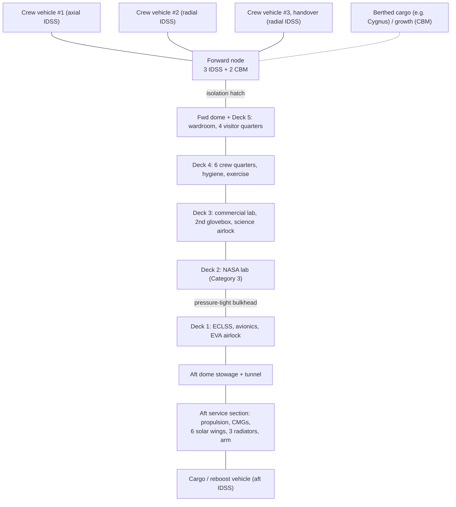
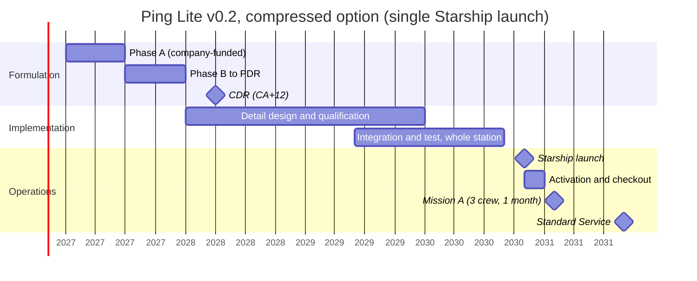

# How to read this document

This is the **second concept iteration** of **Ping Lite** (project working name; the public repository is `new-space-station`). Version 0.1 (18 Oct 2026, kept unchanged in `docs/`) used a five-module station launched on five Falcon rockets. **v0.2 changes the architecture to one large, pre-integrated core station launched on a single Starship flight.** This is the same approach Starlab has publicly announced. v0.2 also closes the main gaps against NASA's Commercial LEO Destination Contract (CLDC) Final RFP, solicitation 80JSC027R0004 (released 9 Oct 2026). The five-Falcon modular design is kept as a documented fallback (Section 14.2, trade T1).

Every number is an **engineering estimate** unless it is labelled as a published figure, and published figures name their source. RFP references give the section and page of the local copies in `refs/`. RFP pages are the printed page numbers, and SOW pages are "Page X of 55". Nothing here claims any real agreement with any company or agency. Partners are described only by type.

## What changed from v0.1

| Area | v0.1 | v0.2 | Section |
|---|---|---|---|
| Launch architecture | 5 elements on 5 launches (3 Falcon Heavy + 2 Falcon 9), assembled in orbit | **1 integrated core station on 1 Starship launch**, outfitted on the ground; deployable arrays and radiators | 3, 11 |
| Permanent crew (berths) | 4 (8 peak) | **6: 4 government + 2 commercial** (10 peak for 30 days or less) | 0, 1 |
| Pressurized / habitable volume | ≈485 / ≈265 m³ | **≈560 / ≈305 m³** | 4 |
| Orbit-average power at end of life (EOL) | ≈35 kW (12 kW payloads) | **≈55 kW capability against a 50 kW design target** (18 kW payloads: 8 NASA + 10 commercial) | 6, 12 |
| Solar arrays | 4 wings × 75 m² | **6 wings × 75 m²** (same wing design) | 6 |
| Radiators | ≈175 m² | **≈265 m²** (3 deployable wings + body-mounted) | 7 |
| Mass | ≈84 t total across 5 launches | **≈93 t launch mass in one launch**, including 25% growth allowance (≈86 t if consumables are offloaded) | 12 |
| Docking ports | 3 IDSS docking + 4 berthing | **4 IDSS docking + 2 CBM-type berthing** | 3 |
| Science | "≥12 racks" | **Mapped to NASA Table 1.5-1 Category 3:** 58 locker locations (40 heritage-compatible), 3 rack-equivalent spaces, 12 powered payloads, 150 CTBE, 150 L cold stowage, vacuum/O₂/N₂ ports, glovebox, workbench | 5A |
| First launch | ≈2033 baseline | **Planning baseline: Q4 2032. Compressed option: Q4 2030 (low likelihood)** | 13 |
| Cost to full capability | \$4–6 B | **≈\$4–7 B** (ROM) | 13 |
| New sections | — | Mission A, B and Standard phasing; transport; teaming and past performance; NASA-aligned funding; compliance matrix; ISS relationship and transition; NASA software testing path | 5B, 11A, 11B, 11C, 13A, 13B, 16 |

# 0. Baseline assumptions (change these first)

| # | Assumption | v0.2 baseline value | Why | Sensitivity if changed |
|---|---|---|---|---|
| A1 | Owner/operator | Private U.S. commercial operator. NASA buys services under CLDC (CLINs 1–5); others are commercial customers | CLDC is service-based (SOW §1.0, p. 6) | High: NASA certification scope |
| A2 | Orbit | Circular, 420 km nominal (400–450 km band), 51.6° | Section 2 (unchanged) | High |
| A3 | Permanent crew | **6 = 4 USG + 2 commercial** | NASA may buy up to 4 USG crew (SOW §3.3, p. 51); 2 extra berths keep commercial capacity | High: ECLSS, volume, logistics |
| A4 | Peak crew | **10 for 30 days or less** (6 + one 4-seat crew vehicle) | Handover and visitors | Medium |
| A5 | Uses | NASA research (Category 3), commercial research and manufacturing, private astronauts, Earth observation | — | Medium |
| A6 | Design life | 15 yr primary structure; replaceable arrays, batteries and ECLSS units | — | Medium |
| A7 | Launch vehicle | **One Starship (SpaceX)**, standard 9 m fairing class, single launch, no on-orbit assembly. Fallback: modular design on Falcon Heavy, New Glenn or Vulcan (T1) | Single integrated launch; no assembly risk | **Very high:** Starship payload capability, payload-bay configuration and NASA launch-category status are not yet proven (R1–R3) |
| A8 | Station envelope | Pressure shell ≈7.2 m outer diameter / ≈7.0 m inside; ≈7.6 m over MMOD shields; ≈17 m stowed length | Fits Starship's published 8 m payload dynamic envelope (Section 4.4) | High |
| A9 | Crew transport | **Crew Dragon** (certified for ISS under CCtCap) baseline. The station accepts any IDSS crew vehicle, including others certified or in certification for ISS as of 1 Oct 2026 | SOW §2.17.1 (p. 38): first 4 increments must use previously certified vehicles | High: single-provider risk |
| A10 | Cargo | **Cargo Dragon** (docking) and **Cygnus** (berthing), both under CRS. Other CRS vehicles if their status allows | SOW §2.17.7 (p. 43): dissimilar redundancy is expected | Medium |
| A11 | Cabin atmosphere | 101.3 kPa, ≈21% O₂ | Unchanged | Low–medium |
| A12 | Safety and certification | Design to CLDP-REQ-1130 Rev D (J-03, RFP p. 145) and certify per CLDP-PLN-2000 (SOW §2.13, p. 29). Two-fault tolerance against catastrophic hazards where practical | CLDC requirement. Library documents not yet reviewed (open item) | High |
| A13 | Program start | Company-funded Phase A from Jan 2027; CLDC award assumed Apr 2027 ("Spring 2027" per NASA) | RFP §L.9 (p. 278) | Schedule |
| A14 | Margins | 25% mass growth allowance (MGA) on dry mass; 15–30% power contingency plus system margin | Normal for concept stage | — |

# 1. Mission and requirements

## 1.1 Mission statement

Ping Lite will provide a continuously crewed, commercially operated station in low Earth orbit that meets NASA's Standard Service Mission (4 crew including at least 2 USG, 6-month increments, Category 3 utilization). It will carry **6 permanent crew (4 government + 2 commercial)** and up to 10 for short periods. The station launches fully outfitted on **one launch**.

## 1.2 Top-level requirements (v0.2)

| ID | Requirement | Value | Rationale / NASA trace | Verification |
|---|---|---|---|---|
| SR-01 | Crew capacity | **6 continuous; 10 for 30 days or less** | SOW §1.2 (≥4 incl. ≥2 USG), §3.3 (up to 4 USG) | Analysis, demo |
| SR-02 | Design life | ≥15 yr structure; ≥10 yr replaceable units | A6 | Analysis, test |
| SR-03 | Orbit | 400–450 km, 51.6° | Section 2 | Analysis |
| SR-04 | Pressurized volume | **≥540 m³** | ≥25 m³ habitable per person at a peak of 10 (Section 4.3) | Inspection |
| SR-05 | Habitable volume | **≥280 m³** | As above | Inspection |
| SR-06 | Continuous power (EOL, orbit-average) | **≥50 kW**, of which ≥8 kW is NASA utilization and ≥10 kW commercial payloads | Section 12.2 | Analysis, test |
| SR-07 | Water recovery | ≥95% at first crew, rising to ≥98% | 5.4 | Test |
| SR-08 | O₂ recovery from CO₂ | ≥45% | 5.3 | Test |
| SR-09 | Ports | **4 IDSS docking ports** (3 crew vehicles + 1 cargo at the same time) **+ 2 CBM-type berthing ports** (berthed cargo, growth) | Handover at 10 crew needs 3 crew vehicles docked; SOW §2.17.7 | Inspection |
| SR-10 | Lifeboat coverage | Docked return seats ≥ crew on board, at all times | Safety | Ops verification |
| SR-11 | Hazard tolerance | Per CLDP-REQ-1130; two-fault tolerant or design-for-minimum-risk | A12 | Analysis |
| SR-12 | MMOD | Probability of no critical penetration ≥0.95 over 10 yr (target) | — | Analysis |
| SR-13 | Reboost | Hold altitude through solar maximum without visiting-vehicle reboost | — | Analysis |
| SR-14 | Collision avoidance | ≥1 m/s within 24 h of a warning | — | Test |
| SR-15 | Communications | ≥1 Gbps payload downlink; ≥95% TT&C coverage; voice, video and telemetry to NASA facilities | SOW §2.16.9.1 | Test |
| SR-16 | EVA | Integrated airlock for 2-person EVA | — | Demo |
| SR-17 | **NASA utilization** | **Meet Table 1.5-1 Category 3 at Standard Service; Category 1 at Mission A** (Section 5A) | SOW §1.5 (pp. 8–11) | Inspection, test |
| SR-18 | Launch compatibility | **One Starship launch.** Station inside the 8 m diameter payload dynamic envelope; stowed length ≤ the confirmed usable height (≤22 m extended volume per the Starship Users Guide); launch mass ≤ performance confirmed by SpaceX to the insertion orbit | A7, A8 | Analysis, launch-vehicle ICD |
| SR-19 | End of life | Controlled deorbit capability | SOW §2.11.5 | Analysis |
| SR-20 | Radiation | NASA-STD-3001 limits; storm shelter ≥10 g/cm² | — | Analysis |
| SR-21 | Leak rate | ≤0.05% of cabin air mass per day (target) | — | Test |
| SR-22 | **Continuous presence** | USG crew gaps of no more than 14 days at handovers | SOW §1.7.2 (p. 12) | Ops |
| SR-23 | **Commander autonomy** | Commander can undock the crew vehicle without ground support; recovery operations without communications | SOW §1.8.1.1 (p. 13) | Training, demo |
| SR-24 | **Transport capability per mission (Category 3)** | Pressurized up 100 CTBE; trash 50; return 50; 4 powered lockers each way; conditioned stowage 70 L up / 70 L down | SOW Table 1.5-1 (p. 10) | Analysis, ops |
| SR-25 | **Internal pressure isolation** | At least one pressure-tight internal bulkhead/hatch zone plus node isolation, so a leak does not force abandoning the whole station (single-volume risk, R6) | New for the single-core design | Analysis, test |

# 2. Orbit selection and rationale

Unchanged from v0.1: **420 km circular, 51.6°**, with a 400–450 km band. This keeps compatibility with ISS-certified crew and cargo vehicles and with ISS ascent, abort and recovery planning. Starship's published reference performance is quoted for orbits up to 500 km and up to 98.9° (Starship Users Guide v1.0, 2020), so 420 km / 51.6° is within the stated range. **Exact performance to a 51.6° insertion orbit must be obtained from SpaceX** (the guide says to contact sales for specific orbits).

## 2.1 Drag at 420 km (v0.2 single-core station)

Station plus up to three docked vehicles ≈125 t (estimate). Ram-facing area ≈500 m² (conservative, dominated by 6 array wings). C_D = 2.2, v = 7,657 m/s.

| Case | Density ρ (estimate) | Drag F | Δv per year | Biprop (Isp 300 s) | Hall EP (Isp 1,500 s) | EP power at 60 mN/kW |
|---|---|---|---|---|---|---|
| Solar mean | 4×10⁻¹² kg/m³ | 0.13 N | 33 m/s | 1.4 t/yr | 0.28 t/yr | 2.2 kW |
| Solar max (high) | 1.5×10⁻¹¹ kg/m³ | 0.48 N | 122 m/s | 5.2 t/yr | 1.04 t/yr | 8.1 kW |

Orbit geometry is unchanged: period 93.0 min, longest eclipse ≈36 min, sunlight ≈57 min, ≈5,650 battery cycles per year.

# 3. Architecture and layout

## 3.1 Architecture choice

**Baseline: a single integrated core station, "Ping Lite Core"**, launched once on Starship. It is a 7.2 m diameter aluminium pressure vessel with five internal decks, a forward docking node, and an aft service section. The aft section carries propulsion, stowed solar wings, stowed radiators and the robotic arm. Everything is integrated and tested on the ground. In orbit, the station deploys its arrays, radiators and arm, completes uncrewed activation and checkout, and is then ready for its first crew.

Why single-launch (changed from v0.1):

1. **No on-orbit assembly.** This removes v0.1 risks R5 (berthing/arm failure before modules are joined) and the 10–12 month assembly campaign.
2. **Ground integration and test of the whole station.** Interfaces are verified end to end before launch, which helps certification (CLDP-PLN-2000).
3. **Fewer pressurized interfaces.** One primary pressure vessel replaces five, so there are fewer CBM seals and leak paths.
4. **Category 3 hardware from day one.** NASA capability phasing (Mission A, then B, then Standard) becomes a matter of certification and operations, not launches.
5. **Precedent:** Starlab has publicly chosen a single Starship launch for a ≈7.7 m diameter, ≈17 m tall, ≈400 m³ station (Starlab website and one-pager, checked Oct 2026).

What it costs: the whole station rides on one launch (R2), it depends on Starship maturity and payload-bay accommodation (R1, R3), large-diameter tooling and facilities are needed, and a single pressure volume needs internal isolation (R6, SR-25).

## 3.2 Configuration

| Zone | Size (estimate) | Main functions |
|---|---|---|
| **Forward node** | ≈2.6 m diameter × 2.5 m | 1 axial IDSS (crew vehicle #1), 2 radial IDSS (crew vehicles #2/#3), 2 radial CBM-type berthing ports (berthed cargo such as Cygnus; growth module). Pressure-tight hatch to the core (isolation zone) |
| **Forward dome** | 7.0 m, 2:1 elliptical head | Logistics stowage; translation to the node; zenith window |
| **Deck 5 (Wardroom)** | 7.0 m Ø × 2.2 m | Galley and wardroom for 10, 4 visitor/handover crew quarters, 3rd hygiene station, cycle ergometer, large Earth-viewing window |
| **Deck 4 (Habitation)** | 7.0 m Ø × 2.2 m | **6 permanent crew quarters** (water-walled storm shelter), 2 hygiene stations, treadmill + resistive exercise device, crew medical station |
| **Deck 3 (Commercial lab)** | 7.0 m Ø × 2.2 m | Commercial payload racks, manufacturing bays (furnace, bioprinting), 2nd (commercial) glovebox, science airlock with slide table |
| **Deck 2 (NASA lab)** | 7.0 m Ø × 2.2 m | NASA Category 3 accommodations (Section 5A): locker carriers, 3 rack-equivalent spaces, NASA glovebox, workbench, cold stowage, vacuum/O₂/N₂ ports |
| **Deck 1 (Systems)** | 7.0 m Ø × 2.2 m | ECLSS racks, avionics, power conversion, **integrated EVA airlock** (crew lock with outward hatch through the barrel; 2 suits), pressure-tight bulkhead to Deck 2 (isolation zone 2) |
| **Aft dome** | 2:1 elliptical head | NASA bulk stowage (150 CTBE) and logistics; tunnel to the aft port |
| **Aft service section** (unpressurized) | ≈7.6 m Ø × ≈3 m | Biprop + Hall propulsion and tanks; 4 CMGs; 2 deployable array booms with alpha joints, 6 roll-out wings (stowed); 3 deployable radiator wings; ammonia pump modules; batteries; **aft IDSS** (cargo, reboost, propellant transfer) through a tunnel; robotic arm stowed; Starship payload adapter interface |

Decks are 2.2 m tall, the same deck height Starlab has publicly shown (SpaceNews, mockup reporting). The barrel circumference (≈22 m at 7.0 m inside diameter) gives about **16 usable rack bays per lab deck** at ≈1.05 m pitch (estimate), leaving room for hatches and the central translation path.

**Flight attitude:** long axis along the velocity vector, node forward. Array booms extend port and starboard and track the Sun with alpha joints and beta gimbals. Radiators fly edge-on to the Sun. The station flies near torque-equilibrium attitude.

# 4. Structures and pressurized volume

## 4.1 Primary structure

* **Material:** welded aluminium 2219 or Al-Li 2195 with orthogrid barrel panels, forged rings, 2:1 elliptical domes, and internal deck beams. Large-diameter (≈7 m) welding and tooling are needed (new facility; cost line in 13.1).
* **Design pressure:** MEOP 104 kPa; ultimate factor 2.0 (confirm against CLDP-REQ-1130 and its referenced standards, e.g. ANSI/AIAA S-080, J-03 p. 145).
* **Pressure-only check at r = 3.5 m:** $t_{min} = \dfrac{104\,\text{kPa}\times 3.5\,\text{m}\times 2.0}{270\,\text{MPa}} \approx 2.7\ \text{mm}$. Launch loads (the station is carried in Starship on a mission-unique adapter), fracture control and pressure cycling drive the design to an equivalent skin of ≈7–8 mm (estimate).
* **Shell area:** barrel π × 7.1 × 12 ≈ 268 m², domes ≈100 m², total ≈370 m². At ≈21 kg/m² equivalent that is ≈7.8 t. Rings, domes, hatches, launch interface and thrust structure bring primary structure to ≈12 t, plus ≈5.5 t of secondary structure (decks, rack frames, partitions). All estimates.
* **MMOD:** stuffed Whipple shields on ≈370 m² at ≈10 kg/m² ≈ 3.7 t.

## 4.2 Pressurized volume

| Zone | Geometry | Volume (estimate) |
|---|---|---|
| Barrel | 7.0 m ID × 12.0 m (5 decks) | ≈462 m³ |
| Two 2:1 elliptical domes | (2/3)π r² (r/2) each | ≈90 m³ |
| Forward node | ≈2.0 m ID × 2.5 m | ≈8 m³ |
| **Total pressurized** | | **≈560 m³** |
| **Habitable (≈55% of pressurized, estimate)** | | **≈305 m³** |

## 4.3 Is that enough?

* Using the common ≈25 m³ per person planning guideline: 6 crew need 150 m³, and a peak of 10 needs 250 m³. **≈305 m³ gives ≈51 m³ per person at 6 crew, and ≈22% margin at a peak of 10.**
* NASA Category 3 utilization takes ≈18 m³ of wall volume on Deck 2, and NASA's 150 CTBE needs ≈10 m³ of stowage envelope in the aft dome (Section 5A). This is outfitting volume, so it is already outside the habitable fraction.

| Station | Pressurized | Habitable | Source/status |
|---|---|---|---|
| ISS | ≈916 m³ | ≈388 m³ | NASA facts |
| Starlab | ≈400 m³ | — | Starlab website/one-pager, Oct 2026: 7.7 m × 17 m, 4 continuous / 8 at turnover, single Starship launch, 2029 |
| Vast Haven-1 | 80 m³ | 45 m³ | Vast (as in v0.1) |
| **Ping Lite v0.2** | **≈560 m³ (est.)** | **≈305 m³ (est.)** | — |

## 4.4 Launch-vehicle fit (Starship)

* **Published figures (Starship Users Guide v1.0, March 2020):** 9 m outer-diameter fairing; **8 m diameter payload dynamic envelope**; an **extended payload volume for payloads up to 22 m tall**; **100+ t to LEO** in the fully reusable configuration (orbits up to 500 km, up to 98.9°). The guide shows payload deployment by **opening a clamshell fairing door and tilting the payload and adapter** before separation.
* **Demonstrated so far (public reporting, checked Oct 2026):** 2026 Starship test flights carried payloads of order **35–40 t** (e.g. ≈37.5 t reported for Flight 12, May 2026). The 100 t class is the Block 3 design figure, **not yet demonstrated**.
* **Ping Lite fit:** ≈7.6 m over shields gives ≈0.2 m radial clearance to the 8 m envelope. ≈17 m stowed length is inside the 22 m extended volume (≈5 m margin, subject to the actual nose-taper geometry). Launch mass ≈93 t (Section 12.1) is **≈93% of the 100 t design figure and about 2.5× what has been demonstrated**.
* **Open risks (R3):** (1) whether a ≈7.6 m × 17 m single payload can leave through the standard clamshell door, or needs a mission-unique large door, a jettisonable nose or another deployment method; (2) the actual usable height in the nose taper; (3) the payload adapter and the loads into a crewed pressure vessel; (4) performance to 51.6°; (5) payload-bay environments (acoustics, thermal, contamination). All need a SpaceX payload ICD early in Phase A.

# 5. Environmental control and life support (ECLSS)

## 5.1 Approach

The approach is unchanged from v0.1: ISS-class regenerative ECLSS from the first crew, with dissimilar backups. It is now sized for **6 continuous / 10 peak**. There are two CO₂ removal units, each sized for 6 crew. The O₂ generator is sized for 6 crew continuously, with stored O₂ for peaks. The water processor is sized for 24+ kg/day. Fire detection is fitted per deck, and the isolation zones are described in SR-25.

## 5.2 Per-person metabolic loads (planning values, approximate)

O₂ 0.84; CO₂ 1.04; drinking + food-prep water 2.5; hygiene ≈1.5; food ≈1.8 (kg/person/day). Unchanged from v0.1.

## 5.3 Oxygen loop mass balance (6 crew)

1. O₂ needed: 6 × 0.84 = **5.04 kg/day**.
2. Electrolysis water: 5.04 × 36/32 = **5.67 kg/day**, which yields 0.63 kg H₂/day (315 mol).
3. CO₂ produced: 6 × 1.04 = **6.24 kg/day**.
4. Sabatier (H₂-limited): 315 mol H₂ react with 78.75 mol CO₂ (3.47 kg). This produces **2.84 kg H₂O/day** and 1.26 kg CH₄/day (vented).
5. Closure: 2.84 / 5.67 = **50%**. 2.77 kg CO₂/day is vented.
6. Electrolysis power: 5.04 kg/day × ≈30 MJ/kg ≈ **1.75 kW** average.

## 5.4 Water loop and resupply impact

* Water processed: 6 × ≈4 = **24 kg/day**. A 98% recovery rate loses ≈0.5 kg/day. Including O₂ make-up and the offsets from food and metabolic water, **net water resupply is ≈1.5–3 kg/day ≈ 0.6–1.1 t/yr** (estimate).
* Open loop would need ≈30 kg/day ≈ 10.8 t/yr. **Regeneration saves ≈10 t/yr of upmass.**

## 5.5 Atmosphere and leakage

Cabin air ≈560 m³ × 1.2 kg/m³ ≈ 670 kg. At 0.05%/day the leak is ≈0.34 kg/day ≈ **123 kg/yr**. On top of that come airlock losses and NASA payload gas use from the O₂/N₂ ports (allocation 50–100 kg/yr, estimate, TBC against CLDP-STD-1106).

## 5.6 Logistics resupply (6 crew, estimate)

| Item | t/yr |
|---|---|
| Food | 3.9 |
| Water (net) | 0.9 |
| Gas (N₂/O₂ make-up, EVA, payload gas) | 0.6 |
| Spares and maintenance | 2.6 |
| Crew supplies | 0.75 |
| Chemical propellant | 1.0 |
| Xenon/krypton | 0.3–1.0 |
| NASA utilization upmass | 1–2 |
| Commercial payloads | 2–4 |
| **Total** | **≈13–17 t/yr ≈ 4–5 cargo flights/yr** (assumes ≈3–4 t useful pressurized cargo per flight; confirm with providers) |

# 5A. NASA science accommodations (mapped to SOW Table 1.5-1)

NASA's minimum utilization capability (SOW §1.5, Table 1.5-1, pp. 9–11) is stated in Middeck Locker Equivalents (MLE) and Cargo Transfer Bag Equivalents (CTBE). The Category 3 total of **58 locker locations = 34 locker-style + 3 rack-equivalent volumes × 8 MLE** (note 5: a rack equivalent is 4 vertical × 2 horizontal MLE, contiguous). **40 of the 58 must be compatible with NASA heritage lockers** per CLDP-STD-1102 (note 1). Resource allocations below are **estimates to be confirmed against CLDP-STD-1106 and CLDP-REQ-1130**, which we have not yet obtained (Q11, Q12 in the questions draft).

| NASA item (Category 3) | NASA minimum | Ping Lite v0.2 provision | Location | Volume impact (est.) | Power allocation (est., orbit-average) |
|---|---|---|---|---|---|
| Reconfigurable locker locations | 58 total | **58 for NASA:** 5 locker-carrier bays × 8 MLE = 40 positions (34 to NASA, 6 commercial) + 3 rack-equivalent bays (24 MLE) | Deck 2 | 8 bays ≈ 13.6 m³ wall envelope | 34 lockers ≈1.7 kW; 3 rack-eq ≈3.0 kW |
| Heritage-compatible lockers | 40 of 58 | **All 40 locker-carrier positions** use CLDP-STD-1102 interfaces (34 NASA + 6 commercial). The 3 rack-equivalent bays can also take heritage lockers. Whether those count toward the 40 is open (Q10) | Deck 2 | — | — |
| Rack-equivalent volumes | 3 (8 MLE each) | 3 dedicated bays with power, data, cooling, and vacuum/gas drops | Deck 2 | in the row above | in the row above |
| Deployable pressurized powered payloads | 12 | **12 utility outlet panels** (power + data). 8 on Deck 2/workbench, 4 on Decks 3/5 | Decks 2, 3, 5 | negligible (aisle use) | 12 × 0.1 ≈1.2 kW |
| CTBE stowage | 150 | **150 CTBE** dedicated NASA stowage (≈8 m³ of bags, ≈10 m³ envelope incl. racks) | Aft dome | ≈10 m³ | — |
| Vacuum resource access | 2 | 2 ports (high-vacuum line, valved, through the barrel) | 3 rack-eq bays | small | — |
| Vacuum exhaust access | 3 | 3 ports (separate exhaust line) | rack-eq bays + workbench | small | — |
| Gaseous O₂ / N₂ | 2 / 2 | 2 + 2 ports from station tanks, co-located with vacuum exhaust in ≥1 rack bay (note 2) | rack-eq bays | small | — |
| Potable water access | Yes | Payload water dispenser on Deck 2 | Deck 2 | — | — |
| Conditioned stowage | 150 L total (≥100 frozen, ≥50 refrigerated) | **≈170 L:** 1 cold-stowage rack (≈100 L at −80 °C class + ≈50 L at +4 °C) + 2 powered double-locker freezers (≈20 L, −20 °C) as spare and transfer capacity | Deck 2 | 1 bay + 2 locker positions | ≈1.2 kW |
| Workbench | 1 (NASA use 50%) | 1 fold-down workbench bay with 4 outlets, vacuum exhaust, imaging | Deck 2 | 1 bay | ≈0.2 kW |
| Glovebox | 1 (NASA use 100%) | **1 NASA-dedicated glovebox + 1 commercial glovebox** (because NASA expects 100% use, SOW Table 1.6-1) | Decks 2, 3 | 2 bays | NASA ≈0.5 kW |
| **Total NASA allocation** | | **11 of ≈16 Deck 2 bays + aft-dome stowage** | | **≈18 m³ wall + ≈10 m³ stowage** | **≈7.8 → 8.0 kW allocated** |

**Transport side (Category 3, per mission, SR-24):** 100 CTBE up, 50 trash, 50 return, 4 powered lockers each way, and 70 L conditioned up and down. These are carried by Cargo Dragon (pressurized up/down with return) and Cygnus (up and trash disposal), using powered-locker and cold-bag services from the transport provider (to be confirmed in LOIs).

**Categories 1 and 2:** the station carries Category 3 hardware from launch. Mission A uses a subset of it (≥3 lockers, 2 of them heritage-compatible, 4 powered payloads, 20 CTBE, 20 L frozen). Mission B uses ≥20 lockers, 1 rack-equivalent, 8 powered payloads, 45 CTBE and 60 L conditioned stowage. The difference between categories is **certification and logistics, not hardware**.

# 5B. NASA mission phasing: Mission A, then B, then Standard

| Phase | Configuration | Crew | Duration | Utilization | Enabled by |
|---|---|---|---|---|---|
| Uncrewed activation & checkout (A&C) | Full station, deployed | 0 | ≈1–2 months after launch | — | Launch + deployments |
| **Mission A (crew-tended), CLIN 3A** | Full station, operated crew-tended | **3 (2 USG + 1 contractor commander)** | **1 month** | Category 1 (subset of installed hardware) | Interim certification milestone (J-11 allows interim milestones to order Mission A, RFP p. 184). The first NASA increment includes A&C objectives (SOW §3.3, p. 50) |
| Mission B (continuous), CLIN 3B | Full station | 4 (≥2 USG) | 6 months | Category 2 | Certification for continuous crew |
| **Standard Service, CLIN 3C** | Full station | 4 USG (2–4 bought by NASA) | 6 months | Category 3 | System Certification Review |
| **6-crew full commercial operations** | Full station | 6 (4 USG + 2 commercial), 10 peak | continuous | Category 3 + commercial | Logistics cadence of 4–5 cargo flights/yr |

The Mission A configuration needs: 1 Crew Dragon docked (4 seats for 3 crew), the HAB deck plus 1 lab deck activated, ECLSS in regenerative mode with 30 days of stored O₂/water reserve, and ≈15 kW of load against ≈68 kW orbit-average at beginning of life (BOL). Per J-17 assumptions (RFP p. 261), **no more than 2 Mission A/B missions may come before Standard Service, and no more than 2 missions per year are allowed**. Ping Lite therefore plans **1 Mission A and at most 1 Mission B**, then Standard Service.

# 6. Power

## 6.1 Architecture

Six roll-out solar wings of the same design as v0.1 (75 m² active area each, ROSA/iROSA-type), on two deployable booms with alpha rotary joints and per-wing beta gimbals. Two-axis tracking is required at 51.6° (β up to ≈75°). Li-ion batteries in N+1 strings. 120 Vdc main bus plus a high-voltage converter for the Hall thrusters.

## 6.2 Array sizing

Design target **50 kW orbit-average at EOL**: 38.7 kW demand including contingency, plus system margin (Section 12.2).

$P_{SA} = \dfrac{50\times36.0/0.75 + 50\times56.9/0.90}{56.9} \approx 97.7\ \text{kW}$ in sunlight at EOL, which needs 97,700 / 237 W/m² ≈ **412 m²**. **Baseline: 6 wings × 75 m² = 450 m².**

| | BOL | EOL (15 yr) |
|---|---|---|
| Array output, sun-pointed | ≈134 kW | ≈107 kW |
| Orbit-average power | ≈68 kW | **≈55 kW** |

Per-m² values are unchanged from v0.1 (297 W/m² BOL, 237 W/m² EOL). All 6 wings deploy at launch, so the reduced-power initial configuration that v0.1 needed is no longer required.

## 6.3 Battery sizing

50 kW × 36 min = 30 kWh delivered, or 33.3 kWh from the cells (0.9 efficiency). At ≤30% depth of discharge that is 111 kWh. With one string of five failed: **≈139 kWh, so 140 kWh nameplate**. At ≈130 Wh/kg that is **≈1.08 t** (estimate).

# 7. Thermal control

Architecture unchanged: water internal loops, ammonia external loop, interface heat exchangers outside the cabin. Heat to reject is ≈50 kW electrical + 1.5 kW metabolic (10 crew peak) + environment, giving a **design value of 57 kW**. At 290 W/m² for a two-sided panel that needs 197 m², or **≈246 m²** with +25% margin. **Baseline: 3 deployable radiator wings × 75 m² + ≈40 m² body-mounted on the service section and barrel = ≈265 m².** The radiators are stowed against the service section for launch (deployment risk R8).

# 8. GNC, propulsion and reboost

* **CMGs:** 4 × ≈1,800 N·m·s (estimate; v0.1 had 1,200). The single body plus 6 wings gives ΔI ≈ 6–8×10⁶ kg·m² (estimate). The gravity-gradient torque at a 5° offset is ≈2–2.7 N·m, so the station must fly torque-equilibrium attitude. Cyclic momentum is of order 1,000–1,300 N·m·s.
* **Hall EP:** 2 operating + 1 spare thrusters of ≈4.5 kW. Solar mean needs 2.2 kW and 0.28 t/yr of propellant. **Solar max needs ≈8.1 kW**, so both thrusters run near full power. Trade T4 looks at a 3rd operating thruster.
* **Biprop:** ≈3.0 t initial load. Annual Δv ≈16 m/s × 125 t / 2,943 ≈ 0.68 t, plus docking RCS ≈0.3 t, gives **≈1.0 t/yr**. Refuelling uses the aft IDSS port's propellant coupling (R9). Visiting-vehicle reboost is the backup.
* **Deorbit:** ≈108 m/s from 420 km for an ≈86 t station needs ≈3.2 t of high-thrust propellant. Baseline: a dedicated deorbit vehicle or tug procured near end of life.
* **Navigation and comms:** unchanged from v0.1 (dual GNSS; optical relay ≥1 Gbps; Ka backup; S-band TT&C with ≈26 dB margin). Voice, video and telemetry interfaces to NASA facilities are added (SOW §2.16.9.1).

# 9. Communications and data

Unchanged from v0.1 Section 9, plus: payload data and command interfaces to NASA's payload operations (as described in RFP L.17.3.1 TA.1 C&DH content, p. 298), an archive of all commands, telemetry, voice and video for the contract period (SOW §2.16.9.1), and separate NASA and commercial payload networks.

# 10. Crew safety, radiation and debris protection

* **Lifeboats:** 6 crew means 2 Crew Dragons docked (8 seats). A handover at 10 crew means 3 crew vehicles (12 seats) on the 3 node IDSS ports, with cargo on the aft port.
* **Depressurisation (single volume):** for a 1 cm² hole, τ = 670 kg / 0.014 kg/s ≈ 13.3 h, and the **time to fall to 70 kPa is ≈4.9 h** (≈30 min for 10 cm²). In v0.1 a leaking module could be closed off. **Here the main volume is one vessel**, so v0.2 adds two pressure-tight isolation zones (node and Deck 1 bulkhead, SR-25), leak location by acoustic sensors, and a patch kit. Evacuation to the docked crew vehicles remains the final control (R6).
* **Radiation, MMOD, medical:** as v0.1. The storm shelter uses the water-walled crew quarters on Deck 4.
* **Fire:** detection per deck; ventilation shutoff per deck; isolation zones.

# 11. Launch, deployment and activation

| Step | Vehicle | Event | Time from launch (estimate) |
|---|---|---|---|
| L1 | **Starship** | Ping Lite Core launched fully integrated (≈93 t, or ≈86 t with consumables offloaded) to an insertion orbit; separation by mission-unique adapter and door/deploy method (R3) | 0 |
| D1 | — | Own propulsion raises the orbit to 420 km; array booms, 6 wings, 3 radiators and the arm deploy; ECLSS and thermal start-up | +1 to +14 days |
| C0 | Cargo Dragon | First cargo: consumables and items offloaded for mass margin, propellant top-up via the aft port (if offloaded) | ≈+1 month |
| A&C | — | Uncrewed activation and checkout complete | ≈+1–2 months |
| C1 | Crew Dragon | **Mission A: 3 crew, 1 month** (first NASA increment includes A&C objectives) | ≈+2–3 months |
| — | Crew/Cargo Dragon, Cygnus | Mission B or Standard Service; then 6-crew operations | ≈+6–12 months |

**Launch count: 1 station launch** (v0.1: 5). After that the station receives only crew and cargo flights.

# 11A. Crew and cargo transportation

The plan uses **ISS-certified vehicles only for the first 4 NASA increments** (SOW §2.17.1, p. 38: certified, or in certification, for ISS under CRS or CCtCap as of 1 Oct 2026).

| Role | Primary | Alternate (status to be verified before proposal) | Port |
|---|---|---|---|
| Crew | **Crew Dragon** (CCtCap, operational) | Other CCtCap vehicle if it meets the "previously certified" definition | IDSS (node axial/radial) |
| Cargo with return (Type 1) | **Cargo Dragon** (CRS) | — | IDSS (any) |
| Cargo without return / disposal (Type 2) | **Cygnus** (CRS) | Other CRS vehicles per their status | CBM-type berthing via the arm (node) |
| Station launch | **Starship** (one flight) | Fallback: modular design (T1) | — |

* **Traffic model at 6 crew (estimate):** crew flights 4/yr (2 NASA rotations of 4 USG crew; 2 commercial rotations of 2 long-duration crew + up to 2 short-stay customers), and cargo flights 4–5/yr.
* **GFTSS:** NASA may provide up to 2 crew and 4 cargo flights per year for the first 4 increments (SOW §2.17.3, p. 39), but no more than 1 crew and 2 cargo flights per increment (J-15, p. 259). Ping Lite prices **end-to-end service with GFTSS as an option** for the first 4 increments. The commercial rotations are always contractor-provided, because GFTSS is not offered for private astronaut missions (SOW p. 40).
* **Redundancy:** IDSS and CBM ports allow dissimilar crew and cargo vehicles (SOW §2.17.7). Stored consumables cover ≥6 months without resupply at 4 crew.
* **Required at proposal:** Letters of Intent from each crew and cargo transport provider covering flight rate, capability and pricing (RFP L.17.3.1 TA.1(5)(B), p. 299). **None exist yet.**

# 11B. ISS relationship and transition

Source for all ISS facts and numbers in this section: `trade-save-iss.md` (19 Oct 2026), which cites NASA, GAO, OIG and ESA documents. **Ping Lite does not propose to save, boost, take over or dock with the ISS.** The proposal treats NASA's plan as fixed: last ISS crew departs mid-2030, US Deorbit Vehicle (USDV) reentry notionally Jan 2031 (trade-save-iss §1). Ping Lite's planning launch is Q4 2032, so on the baseline the two stations never overlap.

**ISS-extension compatibility (unpriced, ≈½ page in the proposal).**

* Ping Lite flies at **420 km / 51.6°** (Section 2), the same inclination as the ISS and within its altitude band (≈415 km). It uses the same **IDSS docking and CBM-type berthing** interfaces and the same ISS-certified crew and cargo vehicles (Crew Dragon, Cargo Dragon, Cygnus; Section 11A).
* GAO reports that NASA will decide in **2027** whether to launch the USDV in 2029 or extend ISS operations, and NASA says the USDV can wait on the ground during an extension (trade-save-iss §1, §4.1).
* **If NASA extends the ISS to ≈2032–33**, Ping Lite could overlap with it. Possible uses: crew handover with no gap in continuous presence, shared crew and cargo traffic planning, and moving small NASA hardware between the stations by visiting vehicle. Ping Lite needs **no added hardware** for this, and the offer depends on nothing NASA has not already planned.
* Ping Lite does **not** depend on an extension. It also has **no** propulsive proximity-operations capability to dock with the ISS. Adding one is not proposed (trade-save-iss option O7: not feasible on the baseline schedule).

**Option 1: host legacy ISS research hardware (optional, priced separately if NASA asks).** Ping Lite offers to accept NASA-owned ISS research hardware that has been returned to the ground, or stored on Axiom's PPTM. NASA asked for PPTM partly to save ISS equipment (trade-save-iss §5, O5). This would use the 40 heritage-compatible locker positions (Section 5A, CLDP-STD-1102) and the 3 rack-equivalent bays, subject to recertification for Ping Lite power, data and thermal interfaces. **Cost and the list of eligible hardware are to be determined** (no estimate yet).

**Option 2: early flight-software demonstration before mid-2030 (optional).** The early demo is **software only**: Ping Lite flight software runs on a computer already hosted on the ISS (or on Axiom's), before the last ISS crew leaves in mid-2030. It flies no Ping Lite hardware and needs no second spacecraft. A dedicated bridge element was assessed and rejected (trade-save-iss O8: estimate \$100–300 M for even a small demo element). Sources are listed in trade-save-iss Appendix A (S21–S29).

*Proven ways to fly software on the ISS:*

| Host | What it has shown | Source |
|---|---|---|
| HPE Spaceborne Computer-2 (SBC-2), via ISS National Lab | Open to proposals; containerised code is built on the ground and pushed to orbit; a Kubernetes (k3s) AI workload deployed by `git push` ran on 24 Jul 2025 | HPE; ISS National Lab; BruhnBruhn |
| Axiom AxDCU-1 (Red Hat Device Edge / MicroShift) | On ISS since CRS-33 (Aug 2025), with remote updates, automated rollback and self-healing; the larger AxODC Node ISS is planned for 2027 | ISS National Lab; Axiom; TechRadar |
| Voyager (formerly Nanoracks) LEOcloud Space Edge micro datacenter, Bishop airlock and external platform | RHEL 10.1 deployed on the ISS unit (May 2026); hosted-payload power, data and mission ops as standard services; software-only SHIRE simulation environment | Voyager; Red Hat/Voyager |
| AWS Snowcone (Ax-1, 2022) | Stock device passed the NASA safety review in about 7 months; operated remotely over SSH; a 7 GB model was uplinked mid-mission | AWS; GeekWire |

*Software to test (flown in monitor-only or "shadow" mode, never commanding the ISS):*

1. **ECLSS control and fault detection, isolation and recovery (FDIR):** run the Ping Lite algorithms against live ISS data and compare their detections with the actual events. Public ISS telemetry is streamed openly (ISSLive / Lightstreamer). Detailed ECLSS data would need a NASA data agreement (TBD).
2. **Autonomous operations and crew-off station management:** run the planner and the safing logic through the station's real communication gaps and loss-of-signal periods. This is the case Ping Lite needs between increments (SR-22) and in crew-tended Mission A.
3. **Power and thermal scheduling:** the Section 6–7 load scheduler, fed with real orbit, beta-angle and eclipse data.
4. **Avionics software stack:** the operating system and container image, deployment pipeline, update and rollback, and radiation-upset logging, run on the hosted computer.

*What it proves for CLDC:*

* **On-orbit evidence for software management and assurance:** SOW §2.10.3 (Software Management Plan, DRD CLDC-107) and §2.11.2 (p. 24: software safety and assurance plan meeting the intent of NASA-STD-8739.8B, plus third-party IV&V).
* **Practice with the payload software path:** SOW §2.15.4 (p. 32).
* **Early data toward human rating:** flight ECLSS and power-control software is Class A under the NPR 7150.2 definition ("required to sustain a safe, habitable environment"). The demo does **not** certify that software, but it gives flight data for FDIR performance and for the assurance case.
* **Past performance:** a flown Ping Lite product before 2030, from a team with no flight record today (Section 13A).

*Rough schedule (estimate):*

| When | Step |
|---|---|
| Q1–Q2 2027 | Pick the host and submit a proposal (HPE SBC-2 via ISS National Lab, Axiom, or Voyager) |
| 2027–2028 | Develop the software and test it on the ground against recorded and public ISS telemetry |
| 2028–2029 | Host safety and integration review. Snowcone's took about 7 months; a software-only load on an existing host is expected to be shorter, but that is not confirmed |
| 2029 to mid-2030 | Flight runs, finishing before the last ISS crew departs. Continue on Axiom's computers after that if available |

**Cost: TBD.** No host publishes a price for this service. The bridge-element figure above does not apply to this option.

**Not included:** ISS boost to a storage orbit, commercial takeover of the US segment, legacy-module reuse and return of modules to Earth. NASA's 2024 analysis rejected all of them, and trade-save-iss rates them low feasibility (§5, O3–O6).

# 11C. NASA software testing path

**Short answer: yes, NASA can test and review Ping Lite's software. There are three routes, and only the first is required.** (1) Under the CLDC contract, through insight, NASA-conducted IV&V and Government IV&V requested through a Government Task Agreement (GTA). (2) Before award, or alongside the contract, through a **reimbursable Space Act Agreement** with JSC and/or the NASA IV&V Program, which Ping Lite pays for. (3) For the Section 11B Option 2 hosted demo, through the **host's and the ISS payload safety review**. Sources are listed at the end of this section.

**What the CLDC RFP requires (refs/, checked 19 Oct 2026):**

* **SOW §2.10.3:** Software Management Plan, DRD CLDC-107.
* **SOW §2.10.5 (p. 22):** provide data and support for **NASA-conducted IV&V**, as needed (Clause H.14; DRD CLDC-104).
* **SOW §2.11.2 (p. 24):** a software safety and assurance plan meeting the **intent of NASA-STD-8739.8B** (Chapter 4 and Appendix A), plus a plan for **third-party software IV&V**. Government IV&V support may be requested through **Attachment J-14 GTAs**.
* **SOW §2.15.4 (p. 32):** test NASA payload software against the station software.
* **J-03 Tables J-03.2/3 (pp. 148, 153):** list **NPR 7150.2D**.
* **J-11 (p. 177):** before CDR, deliver a summary of software requirements and design analysis "per IV&V and Software Assurance" that confirms maturity, plus preliminary software test plans.
* **§L.17.3(f) (pp. 295–296):** GTA forms go to the Center Partnership Office points of contact (Attachment L-06) **no later than 22 days after release (≈31 Oct 2026; see Q13)**. NASA evaluates them as part of the technical and management approach.

**How NASA would classify and assure it:** Ping Lite's ECLSS, power and vehicle-control software meets the NPR 7150.2D Appendix D definition of **Class A** (human-rated: "required to sustain a safe, habitable environment"). Assurance scales with class and safety criticality under NASA-STD-8739.8, and must be independent of the developers. Within NASA, IV&V under SWE-141 is tied to project category and selection, not to Class A alone. For CLDC, the contract mechanism is the SOW §2.11.2 IV&V plan.

**Who could do the work:**

| NASA resource | What it offers | Access route |
|---|---|---|
| **NASA IV&V Program, Fairmont, WV** | Full-lifecycle IV&V, independent assessments, hazard analysis, software assurance plan evaluation, security testing, and static/dynamic analysis in its JSTAR lab. Mainly serves NASA missions, but "projects outside of these requirements can also contact" it, including for "a space act agreement". It supported Commercial Crew software for SpaceX and Boeing | CLDC: Government IV&V via J-14 GTA. Pre-award: reimbursable SAA (contact listed on NASA's "Doing Business with IV&V" page) |
| **JSC** | **Software Development and Integration Laboratory (SDIL)**: ISS flight-software integration and verification with replica onboard avionics. Simulation and Graphics Branch for real-time simulation | GTA (L-06 JSC point of contact) or reimbursable SAA. Precedent: Axiom's reimbursable SAA umbrella agreement with JSC for "services, testing, and capabilities" (SAA-24-CA-41489) |
| **Core Flight System (cFS)** | NASA open-source flight software framework (Apache 2.0). Gateway uses it, and the cFS team is producing a **Class A-certifiable** release. A Government-use distribution is available through a Software User Agreement. The open bundle "should not be flown as is" | Download; Software User Agreement for the Government-use version |

**Reimbursable vs funded SAAs:** a *reimbursable* SAA mainly benefits the partner, who pays NASA in advance for NASA goods, services or facilities "not reasonably available" commercially. A *funded* SAA moves NASA money to a partner for a NASA objective, and only after full and open competition. Testing Ping Lite software would be **reimbursable**, or would be done under the CLDC contract or a GTA.

**Commercial Crew lessons (Starliner OFT, Dec 2019):** two software defects escaped testing: a mission elapsed timer that synced with Atlas V before the terminal count, and a service-module disposal-burn error that was found in flight. The joint Independent Review Team made 80 recommendations: 21 on testing and simulation (including an **end-to-end test before every flight**), 10 on software requirements and 35 on process. NASA's response was to **reassess every hazard report with software controls, review software verification plans, and check that test environments were adequate**. For Ping Lite, that means flight-equivalent end-to-end simulation, independent review of test scripts, and treating software hazard controls as an IV&V focus.

**Recommended steps and timeline (estimates):**

| When | Step |
|---|---|
| **By ≈31 Oct 2026** | Submit a GTA request (L-05) for Government IV&V support and JSC SDIL/simulation access through the L-06 points of contact. Confirm the IV&V route with NASA (Q16) |
| Nov–Dec 2026 (proposal) | Name Class A software items; give the SOW §2.11.2 plan outline (independent IV&V provider, or the Government via J-14); base the architecture on cFS (estimate: reduces new code; not quantified) |
| 2027 (award + 0–12 months) | Reimbursable SAA with the IV&V Program if early IV&V is wanted before the GTA is active; IV&V of requirements and design to meet the J-11 pre-CDR software item |
| 2027–2029 | Flight-equivalent software-in-the-loop and hardware-in-the-loop simulator; end-to-end runs before each integrated test (Starliner lesson); Option 2 shadow-mode demo through the host and ISS payload safety review (Section 11B) |
| 2030–2032 | IV&V of code and test results to certification; end-to-end test before launch and before each NASA increment |

**Cost: TBD.** No public price exists for IV&V Program or JSC reimbursable support. Reimbursable SAAs are billed at NASA's cost under NPR 9090.1, and NASA may waive costs.

*Sources:* CLDC RFP 80JSC027R0004 and SOW (refs/); NASA IV&V "Doing Business with IV&V" and "IV&V Capabilities & Services" pages; WV News on IV&V and Commercial Crew; NASA OIG IG-16-028; NAII 1050-1E; NASA "Partnering with NASA"; NASA SAA-24-CA-41489 (Axiom/JSC); NASA SWE Handbook (SWE-020, SWE-022, SWE-141, §7.24); NTRS 20210000650 (cFS Class A certification); github.com/nasa/cFS; NTRS 20230010525 (SDIL); NASA Simulation and Graphics Branch page; NASA blog, SpaceNews and NASASpaceflight on the Starliner OFT Independent Review Team (Feb–Jul 2020); NASA Payload Safety guide (2024).

# 12. Mass and power budgets

## 12.1 Mass budget (tonnes, all estimates)

| Item | Dry CBE |
|---|---|
| Primary structure (shell, domes, rings, launch interface) | 12.0 |
| Secondary structure (5 decks, rack frames, partitions) | 5.5 |
| MMOD shielding | 3.7 |
| Forward node + 4 IDSS + 2 CBM-type | 2.6 |
| Propulsion (dry) | 1.4 |
| GNC (4 CMGs, sensors) | 1.2 |
| Avionics & comms | 2.0 |
| Power (6 wings + gimbals 5.4, 140 kWh battery 1.1, PMAD 0.9) | 7.4 |
| Array booms + 2 alpha joints | 3.0 |
| Thermal (internal loops, 3 radiator wings, pumps) | 5.5 |
| ECLSS (6 crew / 10 peak) | 5.2 |
| Robotic arm | 1.5 |
| Crew systems (10 quarters, 3 hygiene, galley, 2 exercise suites) | 5.4 |
| Payload infrastructure incl. NASA Category 3, 2 gloveboxes, cold stowage, science airlock, windows | 7.0 |
| Stowage racks (incl. 150 CTBE NASA) | 1.0 |
| EVA airlock hardware + 2 suits | 2.0 |
| Harness & outfitting | 2.5 |
| **Dry CBE** | **68.9** |
| MGA (25%) | 17.2 |
| Propellant 3.0 + consumables 1.5 + initial cargo 2.0 | 6.5 |
| **Launch mass (with MGA)** | **≈92.6 (≈93)** |
| Launch mass with consumables and cargo offloaded to the first Cargo Dragon | ≈86 |

**Launch margin check:** 93 t is ≈93% of Starship's 100+ t design figure. That figure is not yet demonstrated, and the inclination penalty for 51.6° is unknown. **Margin is thin to negative until SpaceX confirms performance.** Mitigations: offload up to 6.5 t; burn down MGA as the design matures; insert lower and climb on own propulsion (EP climb time is a trade); fallback T1(b). This is risk R1.

## 12.2 Power budget (orbit-average, EOL)

| Subsystem | CBE (kW) | Contingency | With contingency (kW) |
|---|---|---|---|
| ECLSS (6 crew, incl. electrolysis 1.75 kW) | 6.3 | 20% | 7.5 |
| Thermal control | 2.5 | 20% | 3.0 |
| Avionics, C&DH, comms | 1.8 | 20% | 2.2 |
| GNC | 0.8 | 25% | 1.0 |
| Crew systems (6 crew) | 3.6 | 20% | 4.3 |
| Robotics | 0.4 | 25% | 0.5 |
| **NASA utilization allocation (Section 5A)** | 8.0 | — | 8.0 |
| **Commercial payloads & manufacturing** | 10.0 | — | 10.0 |
| Electric propulsion (solar mean) | 2.2 | — | 2.2 |
| **Total demand** | | | **38.7** |
| **Capability (EOL)** | | | **≈54.6** |
| **System margin** | | | **≈15.9 kW (41% over demand)** |

Solar max: EP rises to 8.1 kW (+5.9), leaving ≈10 kW margin. A 10-crew peak adds ≈2.5 kW, which is within margin. Mission A load is ≈15 kW against ≈68 kW at BOL.

# 13. Cost and schedule

## 13.1 Cost: rough order of magnitude (2026 US\$, ±50% or worse)

| Item | ROM | Notes |
|---|---|---|
| Phase A–B (to PDR), incl. risk reduction | \$0.35–0.55 B | Large-diameter structural test article starts in Phase B |
| Phase C–D: design, qualification, flight station, structural and thermal test articles, software, ground segment | \$2.5–4.0 B | One integrated vehicle (fewer interfaces) offsets the new large-diameter tooling |
| Large-diameter manufacturing and integration facility; transport to the launch site | \$0.2–0.4 B | 8 m class vehicle cannot move by road; waterfront site likely |
| Launch (1 Starship, mission-unique adapter and deployment hardware) | \$0.15–0.4 B | **No public price for this type of mission. Estimate only** |
| Program reserve (≈20–25%) | \$0.65–1.35 B | |
| **Total to operational station** | **≈\$4–7 B** | v0.1: \$4–6 B |
| Annual operations (mission control, sustaining, spares, insurance; excludes crew and cargo transport) | ≈\$0.4–0.8 B/yr | Transport is priced per provider LOI (TBD) |
| Optional: launch insurance or a second flight-spare primary structure | TBD | Mitigates R2 |

## 13.2 Schedule options (honest feasibility)

NASA's goal is continuous USG presence before the ISS deorbit at the **end of CY2030** (SOW §1.0, p. 6). CLDC CLIN 1 requires **CDR no later than award + 12 months and the Integrated Progress Review (IPR) no later than award + 18 months** (J-11 Table 1, RFP p. 163). With award in spring 2027, that means CDR by about Apr 2028.

| Milestone | **Compressed option** ("buy-not-build", single launch) | **Planning baseline** |
|---|---|---|
| Phase A start (company-funded) | Jan 2027 | Jan 2027 |
| CLDC award (assumed) | Apr 2027 | Apr 2027 |
| PDR | Q4 2027 | Q3 2028 |
| CDR | **Q2 2028 (CA+12, meets J-11)** | Q3 2029 (**misses the J-11 CA+12 limit; needs tailoring, see Q5**) |
| IPR | Q3–Q4 2028 (CA+15–18) | 2029 |
| Structural qualification | 2028–2029 | 2029–2031 |
| Integration and test of the whole station | 2029–Q3 2030 | 2031–Q3 2032 |
| **Launch** | **Q4 2030** | **Q4 2032** |
| A&C complete | Q1 2031 | Q1 2033 |
| **Mission A (3 crew, 1 month)** | **Q1 2031** | Q1 2033 |
| Standard Service | H2 2031 | H2 2033 |
| 6-crew operations | 2032 | 2034 |

**Feasibility assessment (judgment, not analysis):**

* **A single integrated launch does help the schedule.** It removes the v0.1 assembly campaign (10–12 months from first launch to full capability) and the need to certify several element interfaces in orbit. The station reaches Category 3 hardware capability on day one.
* **Even the compressed option lands the first crew about 1–3 months after the end-2030 ISS deorbit target**, not before it. It also needs CDR-to-launch in about 30 months for a first-of-a-kind 7 m class crewed station by a new company. For comparison, Starlab, with an experienced team, completed CDR in February 2026 and targets a 2029 launch, which is about 3+ years (v0.1 sources).
* **It also depends on factors outside our control:** Starship reaching ≈90+ t operational performance with a station-sized payload deployment method, and a NASA launch-category path (SOW §2.17.5), by 2030.
* **Our judgment: the compressed option has a low likelihood (well under 50%; roughly 1-in-5 or less) for a standalone new entrant.** The planning baseline (launch Q4 2032) is the realistic case. Proposing the compressed dates would risk being rated not credible. Proposing the baseline means arriving after ISS, which NASA may rate as a weakness (Q4 in the questions draft).
* **Options to be honest about in the proposal:** (1) bid the baseline with Mission A and Standard Service pricing starting in 2033; (2) bid the compressed option only with an experienced major partner who supplies the pressure vessel and ECLSS heritage; (3) supply Ping Lite elements or subsystems to an established bidder; (4) use the H.5 on-ramp later.

# 13A. Teaming and past-performance strategy

**No agreements exist.** This section describes the types of partners needed and why, mapped to what the RFP evaluates.

* **What NASA evaluates:** up to 3 of the prime's own recent contracts plus up to 2 each for up to 5 major team members (≥\$100 M of base-period work) (RFP L.17.4(a), p. 313). An offeror with no relevant record gets a **neutral** rating (M.5(b), p. 356). CCSC-2 and CDFF agreements count as relevant (M.5, p. 357). The past performance of a parent or affiliate counts only with "meaningful involvement" (L.17.4(e)). CLIN 1 tests **business maturity** (SOW §3.1, p. 50). Financial capability needs statements, investor commitments, and copies of teaming agreements (L.17.5, pp. 316–318).
* **Implication:** as a new entity, Ping Lite's own rating would be neutral. Credibility has to come from major team members with real work share.

| Partner type | Role in Ping Lite | Why it matters to the evaluation |
|---|---|---|
| Large-diameter pressurized-structure manufacturer with human-spaceflight heritage | Pressure vessel, domes, MMOD, structural qualification | Highest technical risk; relevant past performance |
| ECLSS supplier with ISS-class heritage | Regenerative ECLSS racks | Certification heritage; reliability (R5) |
| Power-system supplier (roll-out arrays, PMAD) | 6 wings, booms, alpha joints | Heritage hardware |
| Launch provider (Starship) | Launch, payload adapter, deployment, ICD | LOI required; R1–R3 |
| Crew and cargo transport providers | Crew Dragon, Cargo Dragon, Cygnus services | LOIs required (L.17.3.1 TA.1(5)(B)) |
| Space robotics supplier | Arm and capture | Buy rather than build (T8) |
| Mission operations, training and astronaut-services provider | Ops center, training facility (SOW §2.16.9), commander | Operations past performance |
| Payload integration services company | NASA payload integration (SOW §2.15) | Utilization past performance |
| AS9100 integration and test facility partner | Whole-station AIT | Business maturity |
| Small businesses | Subsystems and services | SBU subfactor (Volume II) |

**Strategy options:** (a) Ping Lite as prime with 3–5 major team members, each holding a defined SOW share; (b) a joint venture with an established aerospace company (JV past performance is weighted per M.5(c)); (c) Ping Lite as supplier/subcontractor to an existing CLDC bidder. **Decision needed before about mid-November 2026** so that Volume III (requested 24 Nov 2026) can be written.

# 13B. Funding model aligned with NASA's service-based payments

**How CLDC pays (RFP sources):**

* **IDIQ, firm-fixed-price.** Guaranteed minimum \$100 M; ceiling \$34.063 B through 2042 (B.8, p. 22). A CLIN 2 award adds a supplement of **4 CLIN 3 service missions, ≥2 of them Standard** (H.32(a), p. 88), with reductions if Standard Service certification is more than 2 years late against the offeror's committed date (H.32(b)).
* **CLIN 1 and 2 are milestone-paid** (performance-based payments, FAR 52.232-32; total ≤90% of price, L.10, p. 278). J-11 percentage ranges: CBR and PDR 10–20% each, CDR 30–50%, IPR ≥20% of CLIN 1; CLIN 2 DCR ≥20%, System Certification 20%, others ≥5% each (RFP pp. 163, 184–185).
* **CLIN 3 per-mission prices** for 2, 3 and 4 USG crew (end-to-end and CLD-only), with 1 or 2 missions per year. **CLIN 4** add-ons (extra seats, utilization, cargo; NASA has first right of refusal on 50/65/75% of available cargo for 2/3/4 seats, SOW Table 3.4.1-1). **CLIN 5** studies.
* **Fair-market pricing:** NASA's price must be equitable with commercial and sovereign customers, and NASA money cannot subsidize private or sovereign seats (H.33, p. 89).

**Ping Lite funding plan (structure, all estimates):**

| Phase | Use of funds | Sources |
|---|---|---|
| 2027–2028 (Phase A to CDR/IPR) | \$0.35–0.55 B + early long-lead items | Equity (seed/Series A–B); CLIN 1 milestone payments (amount competitive and not known); partner cost-share |
| 2028–launch (C/D, facility, launch) | \$3–5 B | Equity growth rounds; strategic partner in-kind work share; CLIN 2 milestone payments; possibly export-credit or asset-backed debt once certification risk falls; customer pre-payments for commercial berths and lab bays |
| Operations | \$0.4–0.8 B/yr + transport | CLIN 3/4 NASA mission revenue (up to 2 missions/yr); 2 commercial long-duration berths (≈4 seats/yr) + short-stay visitors; ≈10 commercial lab bays and manufacturing; sovereign-astronaut missions at H.33-consistent prices |

**Key point:** NASA's money arrives mostly as **service payments after certification**. Development is largely privately financed. CLIN 1/2 milestone payments help but are not expected to cover it. The private raise is still the critical path (R4). The 6-berth design exists so that NASA's 4-seat purchases do not use up all commercial capacity.

# 14. Key risks and open trade studies

## 14.1 Top risks (L = likelihood, C = consequence, 1–5)

| ID | Risk | L | C | Mitigation |
|---|---|---|---|---|
| R1 | **Starship maturity and performance:** 100 t class not yet demonstrated (≈35–40 t payloads in 2026 tests); 51.6° performance unknown; station launch mass ≈93 t | 4 | 5 | Early SpaceX performance quote and ICD; MGA burn-down; offload 6.5 t; keep fallback T1(b) mature to SRR |
| R2 | **Single point of failure at launch:** losing the launch loses the whole station | 2 | 5 | Launch insurance; flight-spare primary structure option; full ground qualification |
| R3 | **Payload bay and door constraints:** how an ≈7.6 m × 17 m crewed station is accommodated, loaded and deployed (clamshell door vs. mission-unique door/nose); bay environments; usable height in the nose | 4 | 5 | Payload ICD in Phase A; mission-unique adapter study; early design accommodation |
| R4 | **Funding and demand** (≈\$4–7 B) | 4 | 5 | Phased raise; partners; anchor customers; 6 berths for commercial revenue |
| R5 | **ECLSS reliability** at 6–10 crew | 3 | 4 | Dissimilar redundancy; long-duration ground test |
| R6 | **Single pressure volume:** a leak or fire affects the whole habitable volume | 3 | 4 | Isolation zones (SR-25); leak location; evacuation to crew vehicles |
| R7 | **NASA launch-vehicle category** (SOW §2.17.5) for Starship by the launch date | 3 | 4 | Category 3 plan or Category 2 path with H.26 insurance; question Q15 |
| R8 | **Deployment failures** (arrays, radiators, booms): no crew present at deployment | 3 | 4 | Redundant actuators; partial-deployment power modes; arm-assisted deployment |
| R9 | **Propellant resupply** interface | 3 | 3 | EP for drag; visiting-vehicle reboost |
| R10 | **Schedule versus ISS deorbit** | 5 | 4 | Compressed option; partnering; honest baseline |
| R11 | **Past performance / business maturity** (new entity) | 4 | 4 | Major team members (13A) |
| R12 | **Crew transport single provider** | 3 | 5 | IDSS for any vehicle; consumables reserve |
| R13 | **Large-diameter manufacturing facility and transport** to the launch site | 3 | 3 | Waterfront site; early facility trade |

## 14.2 Open trade studies

| ID | Trade | Options | Status |
|---|---|---|---|
| **T1** | **Launch architecture** | **(a) v0.2 baseline: single integrated core on 1 Starship.** **(b) Fallback: modular design on Falcon-class vehicles**, resized for 6 crew (see below). (c) 2–3 large modules on New Glenn (7 m fairing) | (a) baseline; (b) kept mature to SRR |
| T2 | Orbit | 51.6°/420 km vs 45°/450–500 km | Unchanged |
| T3 | Habitat construction | Rigid aluminium vs expandable | Unchanged |
| T4 | Reboost | 2+1 vs 3+1 Hall thrusters vs chemical only | Solar-max power |
| T5 | External coolant | Ammonia vs non-toxic | Unchanged |
| T6 | ECLSS closure | ISS-class vs higher O₂ closure | Unchanged |
| T7 | Cabin pressure | 101.3 vs ≈70 kPa | Unchanged |
| T8 | Robotic arm | Buy vs build | — |
| T9 | Bus voltage | 120 vs ≈300 Vdc (larger 55 kW system now favours a study) | Elevated |
| T10 | Transport ownership | End-to-end vs GFTSS for the first 4 increments | New pricing input |
| T11 | Launch mass margin | Offload consumables; lower insertion orbit and EP climb; reduce MGA | New |

**T1(b) fallback, the v0.1 modular design resized for v0.2 requirements (estimates):** 6 elements (Core-Node, Habitat, Lab, Airlock, enlarged Power & Thermal Truss, plus a new Logistics & Habitation Module) on **6 launches (5 Falcon Heavy + 1 Falcon 9)**, ≈110 t total with MGA, ≈615 m³ pressurized / ≈340 m³ habitable, 6 wings × 75 m², ≈55 kW EOL. First crew would come after launch 2, with Mission A on the Core + Habitat. It needs a 10–12 month assembly campaign and extended Falcon fairings (v0.1 risk R2). Cost ≈\$5–8 B (ROM). It avoids Starship dependence but adds assembly risk and launches.

# 15. Next steps

**Next 30 days**

1. **By Wed 21 Oct 2026, 2:00 p.m. ET:** Joshua reviews and submits the clarification questions (`nasa-questions-draft.md`) to jsc-cldc@mail.nasa.gov.
2. Request CLDC Technical Library access (CLDP-REQ-1130 Rev D, CLDP-STD-1102/1106, CLDP-PLN-2000) and fill the TBCs in Section 5A.
3. **Decide by about 31 Oct 2026** whether to request any Government Task Agreements (due 22 days after release).
4. Approach SpaceX for a Starship performance estimate to 51.6° and a payload accommodation/ICD discussion (R1, R3).
5. **Decide the bid posture** (prime / JV / supplier) and start partner outreach (13A).

**Before 8 Dec 2026 (if bidding):** Volume III past performance (requested 24 Nov), transport and launch LOIs, J-11 and J-12 work plans, J-17 mission plan, L-07 business case, and the IMS.

---

# 16. NASA requirements compliance matrix (v0.2, preliminary)

Status key: **Meets** = the design provides it on paper (not yet verified); **Partial** = provided with open items; **Gap** = not met or not yet addressed; **TBD** = requires documents we have not seen.

| # | NASA requirement | Source (section, page) | Ping Lite v0.2 response | Status |
|---|---|---|---|---|
| 1 | ≥4 total crew incl. ≥2 USG (Standard) | SOW §1.2, p. 7 | 6 continuous (4 USG + 2 commercial) | Meets |
| 2 | Up to 4 USG crew purchasable (B/Standard), 3 (A) | SOW §3.3, p. 51 | 4 USG berths; Mission A 3 crew | Meets |
| 3 | Continuous crew, ≤14-day gap | SOW §1.7.2, p. 12 | Overlapping handovers; 3 crew-vehicle ports | Meets |
| 4 | Mission A: 3 crew / 2 USG / 1 month / Category 1 | SOW Table 3.3.1, p. 53 | Section 5B | Meets |
| 5 | Mission B: 4 / 2 / 6 months / Category 2 | SOW Table 3.3.2, p. 53 | Full station | Meets |
| 6 | Standard: 4 / 2 / 6 months / Category 3 | SOW Table 3.3.3, p. 53 | Full station | Meets |
| 7 | Assembly plan from Category 1 to 3 | SOW §1.2, p. 7; L.17.3.1 TA.1(2)(D), p. 297 | Single launch; phasing by certification (5B) | Meets |
| 8 | 58 locker locations, 40 heritage-compatible | SOW Table 1.5-1 note 1, pp. 9–10 | 34 + 3×8; 40 heritage positions | Partial (Q10) |
| 9 | 3 rack-equivalent volumes | Table 1.5-1, note 5 | 3 dedicated bays | Partial (interface TBD, Q10) |
| 10 | 12 deployable powered payloads | Table 1.5-1 | 12 outlet panels | Partial (power per location TBD, Q11) |
| 11 | 150 CTBE stowage | Table 1.5-1 | 150 CTBE, aft dome | Meets |
| 12 | Vacuum resource 2 / exhaust 3 / O₂ 2 / N₂ 2, co-located | Table 1.5-1, note 2 | Provided at rack-equivalent bays | Partial (CLDP-STD-1106 TBD) |
| 13 | Potable water access | Table 1.5-1, note 6 | Dispenser on Deck 2 | Meets |
| 14 | 150 L conditioned stowage (100 frozen, 50 refrigerated) | Table 1.5-1, note 3 | ≈170 L | Meets (temperature ranges TBD) |
| 15 | Workbench (50%), glovebox (100%) | Table 1.5-1; Table 1.6-1, p. 11 | 1 workbench; NASA glovebox + commercial glovebox | Meets |
| 16 | Transport per mission: 100/50/50 CTBE, 4 powered lockers, 70 L conditioned each way | Table 1.5-1, p. 10 | Cargo Dragon + Cygnus | Partial (needs provider LOIs) |
| 17 | First 4 increments on previously certified crew/cargo vehicles | SOW §2.17.1, p. 38 | Crew Dragon, Cargo Dragon, Cygnus | Meets |
| 18 | GFTSS option and traffic model | SOW §2.17.3, p. 39; J-15, p. 259 | Priced as an option; Section 11A | Partial (Q8) |
| 19 | Accommodate ≥1 crew + ≥1 cargo provider; dissimilar redundancy should be supported | SOW §2.17.7, p. 43 | 4 IDSS + 2 CBM-type | Meets |
| 20 | Crew launch from a U.S. site; CONUS / U.S.-waters landing | SOW §2.17.6, p. 43 | Crew Dragon | Meets |
| 21 | Element launch on an NLS Category 3 vehicle (Category 2 with approval) | SOW §2.17.5, p. 42 | Starship. **Current NLS category status not verified** | **Gap / TBD (R7, Q15)** |
| 22 | Cargo launch vehicles with ≥3 successful flights of a similar configuration | SOW §2.17.5, p. 42 | Falcon 9 (Dragon), Cygnus launcher per CRS | Meets (verify) |
| 23 | U.S. commercial provider; domestic source | RFP H.8; L.17.5(b)(3), p. 316 | U.S. company; supplier nationality controls | Partial (corporate set-up) |
| 24 | Certification per CLDP-PLN-2000; requirements CLDP-REQ-1130 Rev D | SOW §2.13, p. 29; J-03, p. 145 | Plan to comply; library access pending | **TBD** |
| 25 | CLIN 1: CDR ≤ CA+12 months, IPR ≤ CA+18 months | J-11 Table 1, p. 163 | Compressed option meets; baseline does not | **Partial / Gap (Q5)** |
| 26 | Activation & Checkout in the first NASA increment | SOW §3.3, p. 50 | Uncrewed A&C + Mission A | Meets |
| 27 | Commander can undock without ground; recovery without communications | SOW §1.8.1.1, p. 13 | Contractor commander, trained | Meets (training plan TBD) |
| 28 | Control centers: commands, telemetry, voice/video to NASA; archive | SOW §2.16.9.1, p. 37 | Section 9 | Meets |
| 29 | High-fidelity training facility | SOW §2.16.9.2, p. 37 | Partner (13A) | Partial |
| 30 | Public affairs: ≥4 minor events/month; ≥7 major events/mission | SOW §2.23, p. 49 | Ops plan | Meets (plan TBD) |
| 31 | Orbital debris, deorbit | SOW §2.11.5 | Controlled deorbit (8) | Partial |
| 32 | Past performance volume | L.17.4, p. 313 | Team-member strategy (13A) | **Gap** (new entity) |
| 33 | Financial capability; teaming arrangements | L.17.5(b)(4), pp. 316–318 | Funding plan (13B); no agreements | **Gap** |
| 34 | Transport and launch LOIs | L.17.3.1 TA.1(5)(B), p. 299 | None yet | **Gap** |
| 35 | Fair market pricing; no subsidy of private/sovereign seats | H.33, p. 89 | Pricing policy (13B) | Meets (policy) |
| 36 | Standard Service commitment date (H.32 Table H.32.1) | H.32, p. 88 | H2 2031 compressed / H2 2033 baseline | Decision needed |

---

## Appendix A. Key equations and constants

As in v0.1: μ = 3.986×10¹⁴ m³/s²; R_E = 6,378 km; g₀ = 9.81 m/s²; σ = 5.67×10⁻⁸ W/m²K⁴; solar constant 1,361 W/m². Orbital velocity √(μ/a); drag ½ρv²C_DA; hoop stress pr/t; radiator ηεσ(T_r⁴ − T_sink⁴); SMAD array sizing.

## Appendix B. Reference figures and their status (v0.2 additions)

| Figure | Value | Source type |
|---|---|---|
| Starship fairing / payload envelope | 9 m OD fairing; 8 m dynamic envelope; extended volume to 22 m height; 100+ t to LEO (reusable, ≤500 km, ≤98.9°); clamshell-door deployment | Starship Users Guide v1.0 (SpaceX, March 2020). May be superseded; confirm with SpaceX |
| Starship demonstrated payload | ≈35–40 t class on 2026 test flights (≈37.5 t reported, Flight 12, May 2026) | Public reporting (Wikipedia summary), checked Oct 2026; secondary source |
| Starlab | 7.7 m × 17 m; ≈400 m³; 4 continuous / 8 at turnover; 35 kW; 500 km / 45°; single Starship; 2029; 130 MLE; 2.2 m deck height | Starlab website/one-pager; Voyager; SpaceNews; checked Oct 2026 |
| CLDC requirements | As cited by section and page | Local copies of Final RFP, SOW J-01, Summary of Changes (`refs/`) |
| All other numbers | Engineering estimates | This document |
